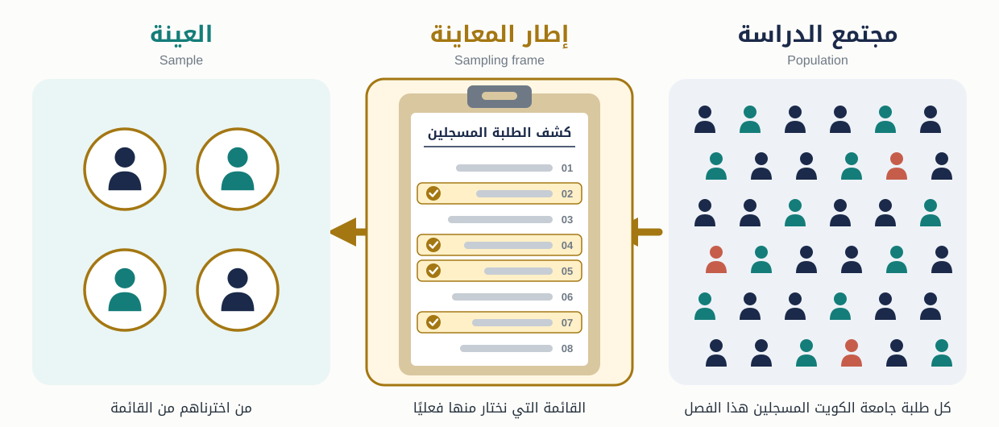
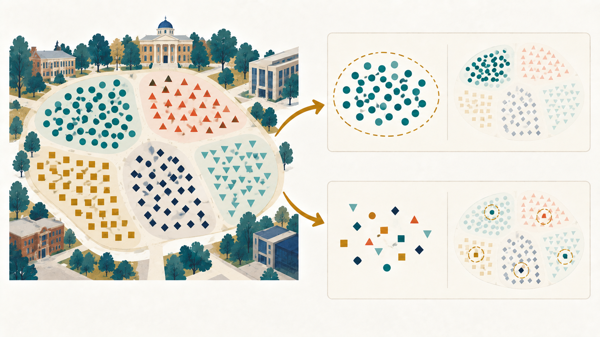

## المحاضرة الأولى: من الأداة إلى من سيجيب عنها

::: {.lecture-divider}
في الفصل السابق سألنا: **كيف نجمع الإجابات من دون أن تصنع الأداة جزءًا من النتيجة؟**

والآن نسأل: **مَن الذي ستُجمع منه هذه الإجابات، ومَن تسمح لنا العينة أن نتحدث عنه؟**
:::

## استرجاع: عينة ممتازة لا تصلح قياسًا ضعيفًا

::: {.question-box}
نريد قياس **الثقة في الجامعة**، فسألنا عن انتظام الحضور فقط، ثم اخترنا عينة احتمالية ممتازة.

هل أصبح القياس صالحًا للثقة؟
:::

. . .

::: {.takeaway}
العينة تعالج مشكلة **الاختيار والتعميم**؛ ولا تصلح الفجوة بين المفهوم وما قسناه.
:::

## والعكس صحيح أيضًا

::: {.question-box}
استخدمنا مقياسًا صادقًا وثابتًا للضغط الدراسي، لكننا وزعناه على أصدقاء الباحث فقط.

هل نستطيع تعميم النتيجة على جميع طلبة جامعة الكويت؟
:::

. . .

::: {.takeaway}
القياس الجيد لا يجعل عينة غير ممثلة ممثلة.
:::

## خريطة الفصل

::: {.arrow-flow}
مجتمع محدد  
↓  
إطار معاينة مناسب  
↓  
طريقة اختيار واضحة  
↓  
عينة + استجابة فعلية  
↓  
استنتاج بحدود صريحة
:::

## مجتمع الدراسة

::: {.concept-card}
مجتمع الدراسة هو **جميع الوحدات التي نريد وصفها أو تفسيرها أو التعميم عليها**.

<span class="term-en">Population</span>
:::

قد تكون الوحدات أفرادًا، أو أسرًا، أو مؤسسات، أو سجلات، أو منشورات.

## «طلبة الجامعة» ليس مجتمعًا محددًا

نحتاج إلى تحديد:

- أي جامعة أو جامعات؟
- المسجلون في أي فصل؟
- بكالوريوس أم دراسات عليا؟
- كويتيون وغير كويتيين؟
- المنتظمون فقط أم جميع المسجلين؟

::: {.takeaway}
لا يمكن الحكم على تمثيل العينة قبل أن نعرف **المجتمع الذي يفترض أن تمثله**.
:::

## المجتمع المستهدف والمجتمع المتاح

::::: {.columns}
:::: {.column width="47%"}
::: {.concept-card}
**المجتمع المستهدف**

من نريد أن تنطبق عليهم النتيجة.
:::
::::

:::: {.column width="47%"}
::: {.concept-card}
**المجتمع المتاح**

من تسمح القوائم والوصول الفعلي باختيارهم.
:::
::::
:::::

::: {.takeaway}
الفجوة بين الاثنين مشكلة **تغطية** يجب وصفها، لا إخفاؤها.
:::

## العينة

::: {.concept-card}
العينة مجموعة من وحدات مجتمع الدراسة نختارها لجمع البيانات منها.

<span class="term-en">Sample</span>
:::

::: {.arrow-flow}
مجتمع الدراسة ← عملية اختيار ← العينة
:::

::: {.small}
قد تكون وحدة المعاينة مجموعةً مثل المقرر، بينما تكون وحدة التحليل فردًا مثل الطالب.
:::

## التعداد أم العينة؟

::::: {.columns}
:::: {.column width="47%"}
### التعداد

نجمع البيانات من جميع وحدات المجتمع.

<span class="term-en">Census</span>
::::

:::: {.column width="47%"}
### العينة

نجمع البيانات من جزء مختار، ثم نحدد ما يمكن استنتاجه عن المجتمع.
::::
:::::

::: {.small}
حتى التعداد قد يعاني من عدم الاستجابة أو أخطاء القياس أو قوائم غير مكتملة.
:::

## دراسة الطلاق في الفصل

::: {.arrow-flow}
مجتمع مسجّل: 4,072 مطلقة كويتية في سنوات محددة  
↓  
عينة احتمالية مختارة: 300  
↓  
بيانات جُمعت من عدد أقل بسبب الرفض وتعذر الوصول
:::

::: {.question-box}
أي عدد يصف المجتمع؟ وأي عدد يصف العينة المختارة؟ وأي عدد يصف المشاركات الفعليات؟
:::

## نشاط: عرّفوا المجتمع قبل العينة

::: {.question-box}
تريد مجموعة دراسة **اتجاه الطلبة المتعثرين دراسيًا نحو خدمات الإرشاد**.

ما القرارات التي يجب حسمها قبل طلب قائمة الأسماء؟
:::

. . .

::: {.board}
تعريف التعثر · الفصل الدراسي · الجامعة/الكليات · المرحلة · حالة التسجيل · معايير الإدراج والاستبعاد
:::

## متى نقول إن العينة ممثلة؟

::: {.concept-card}
العينة الممثلة تعكس خصائص المجتمع **ذات الصلة بسؤال البحث** بدرجة تسمح باستنتاج مبرر عنه.
:::

::: {.takeaway}
التمثيل ليس تشابهًا شكليًا في كل صفة؛ بل نتيجة لعملية اختيار وتغطية واستجابة مناسبة.
:::

## ليست مسابقة لمطابقة كل صفة

قد لا نحتاج أن تطابق العينة المجتمع في:

- لون الهاتف
- الحرف الأول من الاسم
- شهر الميلاد

لكن قد نحتاج الانتباه إلى:

- الكلية أو المرحلة
- الجنس أو العمر
- المتغيرات المرتبطة بالنتيجة والاستجابة

::: {.small}
تتحدد الخصائص المهمة من سؤال البحث ومعرفة مصادر التحيز المحتملة.
:::

## الاحتمال المعروف أهم من «التشابه» وحده

::: {.concept-card}
في العينة الاحتمالية، لكل وحدة مؤهلة **احتمال اختيار معروف وغير صفري**.
:::

::: {.small}
لا يشترط أن تكون الاحتمالات متساوية في كل تصميم؛ يمكن أن تختلف إذا عُرفت وأُخذت في التحليل.
:::

::: {.takeaway}
الاختيار الاحتمالي يسمح بتقدير خطأ المعاينة؛ لكنه لا يضمن وحده أن البيانات النهائية بلا تحيز.
:::

## الاختيار ليس الاستجابة

::: {.arrow-flow}
أُدرج في الإطار  
↓  
اختير للعينة  
↓  
أمكن الوصول إليه  
↓  
وافق على المشاركة  
↓  
أكمل الأداة
:::

::: {.takeaway}
قد يبدأ التصميم باختيار احتمالي ثم تتغير تركيبة المشاركين بسبب عدم التغطية أو عدم الاستجابة.
:::

## إطار المعاينة

::: {.concept-card}
إطار المعاينة هو القائمة أو الآلية العملية التي نستخدمها للوصول إلى وحدات المجتمع واختيار العينة.

<span class="term-en">Sampling Frame</span>
:::

::: {.example-box}
قائمة الطلبة المسجلين · سجل الموظفين · عناوين المساكن · قائمة المدارس
:::

## المجتمع ليس هو الإطار

{.chapter-figure .figure-frame fig-alt="مجتمع الدراسة، ثم كشف الطلبة المسجلين بوصفه إطار المعاينة، ثم العينة المختارة من الكشف. بعض أفراد المجتمع باللون الأحمر لا يظهرون في الكشف."}

::: {.question-box}
الأشخاص باللون الأحمر مؤهلون، لكنهم غائبون عن الإطار. هل يملكون فرصة أن يُختاروا؟
:::

. . .

::: {.takeaway}
لا. من لا يظهر في القائمة—مثل من سجّل متأخرًا—لا تصله فرصة الاختيار أصلًا.
:::

## نشاط: شخّصوا إطار المعاينة

::: {.question-box}
نريد دراسة جميع طلبة جامعة الكويت، واستخدمنا قائمة متابعي حساب طلابي في إنستغرام إطارًا للمعاينة.

من قد يغيب؟ ومن قد يظهر أكثر من مرة أو من خارج المجتمع؟
:::

. . .

::: {.board}
غير المتابعين · قليلو استخدام المنصة · حسابات غير نشطة أو متعددة · خريجون أو أشخاص من خارج الجامعة
:::

## خطأ التغطية

::: {.concept-card}
يحدث عندما لا يطابق إطار المعاينة مجتمع الدراسة: قد يستبعد وحدات مؤهلة أو يضم وحدات غير مؤهلة أو يكررها.

<span class="term-en">Coverage Error</span>
:::

::: {.takeaway}
السحب العشوائي من قائمة ناقصة ينتج اختيارًا عشوائيًا **من القائمة الناقصة**، لا من المجتمع كاملًا.
:::

## ليست كل القوائم متساوية

يشير الفصل إلى أطر مثل:

- سجلات المدارس والجامعات والوزارات
- قوائم الناخبين أو أعضاء الجمعيات
- عناوين المساكن أو سجلات السكان
- دليل الهاتف

::: {.question-box}
ما الفئات التي قد يستبعدها دليل هاتف أو قائمة رقمية قديمة؟
:::

## فحص جودة الإطار

اسألوا:

1. هل يغطي جميع المؤهلين قدر الإمكان؟
2. هل يضم غير المؤهلين؟
3. هل توجد وحدات مكررة؟
4. هل بيانات الاتصال حديثة؟
5. هل يمكن الوصول إلى الوحدات أخلاقيًا وعمليًا؟

## مختبر مشروعكم: المجتمع والإطار

::: {.question-box}
اكتبوا لمشروعكم:

1. من هو المجتمع المستهدف؟
2. من يشمله المجتمع المتاح؟
3. ما إطار المعاينة الممكن؟
4. من قد يغيب عنه؟
5. كيف يحد ذلك من التعميم؟
:::

## لماذا نستخدم عينة؟

::::: {.columns}
:::: {.column width="47%"}
- توفير الوقت والمال
- إمكان متابعة جودة الجمع
- تدريب وإشراف أفضل
::::

:::: {.column width="47%"}
- الوصول إلى مجتمع كبير
- تقليل عبء الاتصال
- أحيانًا قياس أدق من تنفيذ واسع ضعيف
::::
:::::

::: {.takeaway}
العينة ليست حلًا اضطراريًا رديئًا؛ قد تكون تصميمًا أفضل إذا اختيرت ونُفذت جيدًا.
:::

## حجم العينة: خرافة الـ 5%

::: {.question-box}
هل يجب دائمًا أن تكون العينة 5% أو 10% من المجتمع؟
:::

. . .

::: {.takeaway}
لا. لا توجد نسبة ثابتة تصلح لكل دراسة، ومجتمع أكبر لا يتطلب دائمًا النسبة نفسها أو زيادة متناسبة في العينة.
:::

## ما الذي يحدد الحجم؟

يعتمد على:

- هدف الدراسة ونوع التحليل
- مقدار الدقة المطلوبة
- تباين المجتمع
- تصميم المعاينة
- حجم الفئات التي نريد مقارنتها
- الاستجابة المتوقعة

::: {.small}
نحسب أولًا عدد الحالات المكتملة المطلوبة، ثم نرفع عدد الدعوات لتعويض عدم الاستجابة المتوقع. أما الموارد فتقيّد ما نستطيع تنفيذه، ولا تجعل العدد غير الكافي كافيًا.

في التجارب يدخل حجم الأثر والقوة الإحصائية؛ وفي الدراسات النوعية يختلف منطق الكفاية.
:::

## التجانس والدقة

::::: {.columns}
:::: {.column width="47%"}
**مجتمع أكثر تجانسًا**

قد نحتاج عددًا أقل لتقدير سمة محددة بالدقة نفسها.
::::

:::: {.column width="47%"}
**مجتمع أكثر تباينًا**

قد نحتاج عددًا أكبر أو تصميمًا يضمن تمثيل الفئات المهمة.
::::
:::::

::: {.takeaway}
كلما طلبنا دقة أعلى، احتجنا عادةً عينة أكبر—مع ثبات بقية العوامل.
:::

## الكبير لا يعالج التحيز

::: {.question-box}
استبانة اختيارية عبر رابط نشره مؤثر تقني حصلت على 50,000 إجابة.

هل أصبحت ممثلة لسكان الكويت؟
:::

. . .

{.chapter-figure .figure-sampling fig-alt="عينة كبيرة مأخوذة من مجموعة واحدة مقارنة بعينة أصغر موزعة على مجموعات المجتمع المختلفة."}

::: {.takeaway}
الحجم يقلل خطأ المعاينة العشوائي، لكنه لا يصلح تلقائيًا خطأ التغطية أو الاختيار الذاتي أو عدم الاستجابة.
:::

## نشاط: أيهما أقوى؟

::: {.question-box}
**أ.** 600 طالب اختيروا عشوائيًا من سجل حديث، واستجاب 75% منهم.  
**ب.** 8,000 إجابة من رابط مفتوح في حساب طلابي.

أي عينة تسمح بتعميم أقوى؟ وما المعلومات الناقصة؟
:::

. . .

::: {.takeaway}
نحتاج طريقة الاختيار، وجودة الإطار، ومعدل الاستجابة، ومن استجاب ومن غاب—لا العدد وحده.
:::

## فئتان رئيستان

::::: {.columns}
:::: {.column width="47%"}
::: {.concept-card}
**عينات احتمالية**

احتمال الاختيار معروف وغير صفري.

<span class="term-en">Probability Sampling</span>
:::
::::

:::: {.column width="47%"}
::: {.concept-card}
**عينات غير احتمالية**

لا نستطيع تحديد احتمال اختيار كل وحدة.

<span class="term-en">Non-probability Sampling</span>
:::
::::
:::::

## الفرق ليس «جيدة» و«سيئة»

::::: {.sampling-grid}
::: {}
**إذا كان الهدف تقدير نسبة في مجتمع**

نحتاج عادةً تصميمًا احتماليًا وتغطية واستجابة مناسبتين.
:::
::: {}
**إذا كان الهدف فهم خبرة نادرة أو مخفية**

قد تكون عينة غير احتمالية أكثر واقعية وملاءمة.
:::
::: {}
**الاحتمالية**

تدعم الاستدلال الإحصائي، لكنها قد تكون مكلفة أو غير ممكنة.
:::
::: {}
**غير الاحتمالية**

قد توفر عمقًا أو وصولًا، لكن حدود تعميمها أضيق.
:::
::::

## سؤال القرار

::: {.question-box}
ما نوع الدليل الذي نحتاجه؟

- تقدير نسبة أو متوسط في مجتمع؟
- مقارنة فئات محددة؟
- الوصول إلى فئة يصعب حصرها؟
- فهم حالات غنية بالمعلومات؟
:::

::: {.takeaway}
نختار الطريقة من **هدف البحث وإمكان الوصول**، ثم نصف حدودها بصدق.
:::

## المحاضرة الثانية: العينات الاحتمالية

::: {.lecture-divider}
أربع طرق في الفصل:

**العشوائية البسيطة · المنتظمة · الطبقية · العنقودية**
:::

## ما معنى «عشوائية»؟

::: {.question-box}
هل تعني أن الباحث يختار أي شخص «يصادفه» من غير ترتيب؟
:::

. . .

::: {.takeaway}
لا. العشوائية إجراء اختيار لا يعتمد على تفضيل الباحث، ويمنح الوحدات احتمالات اختيار معروفة.
:::

## ١. العينة العشوائية البسيطة

::: {.concept-card}
تُختار وحدات من إطار كامل بحيث تكون لكل وحدة مؤهلة فرصة أولية متساوية للدخول في العينة.

<span class="term-en">Simple Random Sample</span>
:::

::: {.arrow-flow}
قائمة كاملة ← رقم لكل وحدة ← مولّد عشوائي ← وحدات مختارة
:::

## خطواتها

1. نحدد المجتمع ومعايير الأهلية.
2. نبني إطارًا يضم الوحدات مرة واحدة.
3. نعطي كل وحدة رقمًا.
4. نستخدم مولّد أرقام عشوائية.
5. نوثق القاعدة والنتيجة.

::: {.small}
جداول الأرقام العشوائية الواردة في الفصل تؤدي الوظيفة نفسها التي تؤديها البرامج الحديثة.
:::

## السحب من دون إرجاع

::: {.question-box}
إذا ظهر الرقم نفسه مرتين ونحن نريد عينة من أشخاص مختلفين، ماذا نفعل؟
:::

. . .

::: {.takeaway}
في السحب من دون إرجاع، لا نختار الوحدة نفسها مرتين؛ نتجاوز التكرار وفق القاعدة المحددة.
:::

## نشاط: هل هذا اختيار عشوائي؟

::: {.question-box}
أي إجراء عشوائي فعلًا؟

1. أختار الأرقام التي «تبدو موزعة».
2. أغمض عيني وأشير إلى أسماء في القائمة.
3. أستخدم مولّدًا عشوائيًا موثقًا لاختيار 200 رقم فريد.
4. أختار أول 200 اسم لأن القائمة طويلة.
:::

. . .

::: {.board}
الإجراء 3 يقدّم قاعدة قابلة للتكرار والفحص. ويمكن أيضًا إجراء قرعة مادية عادلة إذا مُثلت جميع الوحدات مرة واحدة وخُلِطت جيدًا.
:::

## قوتها وحدودها

::::: {.columns}
:::: {.column width="47%"}
### قوة

- منطق واضح
- تقدير مباشر لاحتمال الاختيار
- لا يحتاج قرارًا بشريًا لكل اسم
::::

:::: {.column width="47%"}
### حدود

- يحتاج إطارًا كاملًا
- قد تكون الوحدات متباعدة
- قد تفوّت فئات صغيرة بالمصادفة
::::
:::::

## ٢. العينة المنتظمة

::: {.concept-card}
نختار بداية عشوائية، ثم نختار كل وحدة رقمها يبتعد بفاصل ثابت.

<span class="term-en">Systematic Random Sample</span>
:::

::: {.sample-math}
k = N / n
:::

<span class="small">حيث \(N\) حجم الإطار، و\(n\) حجم العينة، و\(k\) فاصل الاختيار.</span>

::: {.small}
إذا لم يكن \(N/n\) عددًا صحيحًا، نحتاج إجراءً منهجيًا مناسبًا بدل التقريب العشوائي.
:::

## مثال حسابي

لدينا 1,000 اسم ونريد 100:

::: {.sample-math}
k = 1000 / 100 = 10
:::

إذا كانت البداية العشوائية 5:

::: {.board}
5 · 15 · 25 · 35 · 45 · …
:::

## نشاط: ابنوا العينة

::: {.question-box}
لدينا 2,400 طالب ونريد عينة من 300.

1. ما فاصل الاختيار؟
2. إذا كانت البداية العشوائية 6، فما أول خمسة أرقام؟
:::

. . .

::: {.board}
\(k = 8\) · الأرقام: 6، 14، 22، 30، 38
:::

## أين يظهر الخطر؟

::: {.concept-card}
إذا كان ترتيب القائمة يحتوي نمطًا دوريًا يتوافق مع فاصل الاختيار، قد تتكرر فئة أو تغيب فئة.
:::

::: {.example-box}
قائمة مرتبة في مجموعات ثابتة، وكل ثامن اسم يؤدي الدور نفسه داخل المجموعة.
:::

::: {.takeaway}
نفحص ترتيب الإطار قبل استخدام الاختيار المنتظم.
:::

## القائمة المرتبة ليست دائمًا مشكلة

قد يفيد الترتيب أحيانًا في نشر العينة عبر المجتمع، لكن الخطر يظهر عندما:

- توجد دورية تطابق الفاصل
- تُبنى القائمة في دورات ثابتة تعيد النمط نفسه
- لا يُستخدم إجراء صحيح عندما يكون الفاصل غير صحيح

::: {.small}
الحل ليس خلط القائمة آليًا دائمًا؛ بل فهم بنيتها واختيار تصميم مناسب.
:::

## البسيطة أم المنتظمة؟

::::: {.columns}
:::: {.column width="47%"}
**العشوائية البسيطة**

نختار كل الأرقام عشوائيًا.
::::

:::: {.column width="47%"}
**المنتظمة**

بداية عشوائية واحدة، ثم فاصل ثابت.
::::
:::::

::: {.takeaway}
المنتظمة أسهل في التنفيذ غالبًا، بشرط ألا يصنع ترتيب الإطار تحيزًا.
:::

## ٣. العينة الطبقية

::: {.concept-card}
نقسم المجتمع إلى طبقات غير متداخلة تغطي المجتمع كله، ثم نختار عينة احتمالية من **كل طبقة**.

<span class="term-en">Stratified Random Sample</span>
:::

::: {.arrow-flow}
مجتمع غير متجانس ← طبقات ← عينة من كل طبقة ← دمج
:::

## متى نستخدمها؟

- عندما نحتاج ضمان تمثيل فئات مهمة.
- عندما تختلف الفئات في المتغير المدروس.
- عندما نريد تقديرات منفصلة لكل فئة.
- عندما قد تفوّت العينة البسيطة فئة صغيرة.

::: {.example-box}
رتبة أعضاء هيئة التدريس · الكلية · المرحلة الدراسية
:::

## التوزيع النسبي

إذا كان المجتمع:

::: {.board}
10% أساتذة · 35% أساتذة مشاركون · 55% أساتذة مساعدون
:::

وعينتنا 1,000:

::: {.board}
100 · 350 · 550
:::

::: {.takeaway}
في التوزيع النسبي، تعكس حصة كل طبقة نسبتها في المجتمع.
:::

## وقد نأخذ عددًا أكبر من طبقة صغيرة

إذا كانت فئة مهمة صغيرة جدًا، قد نختار منها عددًا أكبر من نسبتها لكي نستطيع تحليلها.

::: {.takeaway}
هذا لا يجعل التصميم غير احتمالي، لكن يجب استخدام أوزان تعكس معكوس احتمالات الاختيار عند تقدير خصائص المجتمع كله.
:::

::: {.small}
يسمى ذلك أحيانًا التخصيص غير المتناسب أو الإفراط في معاينة فئة صغيرة.
:::

## نشاط: صمّموا طبقات

::: {.question-box}
نريد مقارنة تجربة التسجيل بين طلبة:

- الكليات العلمية والإنسانية
- السنوات الأولى والنهائية

ويقتصر المجتمع المستهدف على هاتين المرحلتين.

ما الطبقات الممكنة؟ وكم طبقة تنتج من الجمع بين المتغيرين؟
:::

. . .

::: {.board}
علمية/أولى · علمية/نهائية · إنسانية/أولى · إنسانية/نهائية = 4 طبقات
:::

## ٤. العينة العنقودية

::: {.concept-card}
نقسم المجتمع إلى مجموعات طبيعية، ثم نختار **بعض العناقيد**، وقد نختار داخلها على مراحل.

<span class="term-en">Cluster Sample</span>
:::

::: {.small}
قد ندرس جميع الوحدات داخل العناقيد المختارة، أو نختار عينة أخرى منها؛ لذلك ليست كل عينة عنقودية متعددة المراحل.
:::

::: {.arrow-flow}
مناطق ← قطع ← مساكن ← أفراد
:::

## مثال انتخابي كويتي

إذا لم تتوفر قائمة موحدة بجميع الناخبين:

1. نختار مناطق أو دوائر.
2. نختار قطعًا سكنية داخلها.
3. نختار مساكن.
4. نختار شخصًا مؤهلًا داخل المسكن.

::: {.small}
يجب أن تكون آلية الاختيار احتمالية في كل مرحلة إذا أردنا تصميمًا احتماليًا.
:::

## مثال جامعي

::::::: {.nested-units}
**كليات مختارة**

::::: {}
**أقسام مختارة داخلها**

:::: {}
**مقررات مختارة داخل الأقسام**

::: {}
**طلبة مختارون داخل المقررات**
:::
::::
:::::
:::::::

::: {.takeaway}
تفيد عندما لا توجد قائمة مركزية للأفراد، لكن توجد قوائم للمجموعات.
:::

## المعاينة متعددة المراحل

::: {.concept-card}
العينة العنقودية قد تستخدم أكثر من مرحلة اختيار، مع تقليل الوحدات تدريجيًا حتى نصل إلى وحدة التحليل.

<span class="term-en">Multistage Sampling</span>
:::

::: {.takeaway}
يجب توثيق احتمال الاختيار في جميع المراحل، لا وصف المرحلة الأخيرة فقط.
:::

::: {.small}
الاحتمال الكلي يجمع احتمالات المراحل، وتُبنى الأوزان عليه؛ كما يجب أن تراعي الأخطاء المعيارية تصميم العينة.
:::

## الكفاءة مقابل الدقة

::::: {.columns}
:::: {.column width="47%"}
### ما تكسبه

- تنقل أقل
- قوائم أسهل
- كلفة ووقت أقل
::::

:::: {.column width="47%"}
### ما قد تخسره

- تشابه الأفراد داخل العنقود
- خطأ معاينة أكبر
- تحليل وأوزان أكثر تعقيدًا
::::
:::::

## طبقات أم عناقيد؟

::::: {.columns}
:::: {.column width="47%"}
::: {.concept-card}
**طبقات**

نأخذ عينة من **كل** طبقة لضمان تمثيلها.

نفضّل تجانس الوحدات داخل الطبقة في المتغيرات ذات الصلة.
:::
::::

:::: {.column width="47%"}
::: {.concept-card}
**عناقيد**

نختار **بعض** العناقيد لتسهيل الوصول.

نفضّل أن يضم كل عنقود تنوعًا، لكن وحداته غالبًا تتشابه.
:::
::::
:::::

## نشاط: طبقية أم عنقودية؟

::: {.question-box}
1. نقسم الطلبة حسب الكلية، ثم نختار عينة من كل كلية.
2. نختار أربع كليات عشوائيًا، ثم نختار طلبة داخلها.
3. نقسم السكان حسب المحافظة، ثم نأخذ عينة من كل محافظة.
4. نختار مناطق سكنية، ثم مساكن داخل المناطق المختارة.
:::

. . .

::: {.board}
طبقية · عنقودية · طبقية · عنقودية متعددة المراحل
:::

## الخطر في العناقيد القليلة

::: {.question-box}
اخترنا مقررًا واحدًا عشوائيًا، ثم سألنا جميع طلبته.

هل صاروا ممثلين لجميع طلبة الجامعة لأن المقرر اختير عشوائيًا؟
:::

. . .

::: {.takeaway}
لا. عنقود واحد قد يختلف عن غيره. نحتاج عددًا كافيًا ومتنوعًا من العناقيد، لا عددًا كبيرًا داخل عنقود واحد فقط.
:::

## الطرق الاحتمالية الأربع

```{=html}
<svg class="sampling-svg" viewBox="0 0 1200 520" role="img" aria-labelledby="ps-title ps-desc">
  <title id="ps-title">طرق المعاينة الاحتمالية</title>
  <desc id="ps-desc">العشوائية البسيطة تختار وحدات متفرقة، والمنتظمة تختار بفاصل ثابت بعد بداية عشوائية، والطبقية تختار من كل طبقة، والعنقودية تختار عناقيد كاملة، والعنقودية متعددة المراحل تختار عناقيد ثم وحدات داخلها.</desc>

  <g class="fragment"><g transform="translate(956 0)">
    <rect class="ps-panel" x="10" y="10" width="224" height="450" rx="14"/>
    <rect class="ps-head" x="10" y="10" width="224" height="64" rx="14"/>
    <text class="ps-label" x="122" y="50">عشوائية بسيطة</text>
    <circle class="ps-dot" cx="58" cy="111" r="9"/><circle class="ps-selected" cx="101" cy="96" r="9"/>
    <circle class="ps-dot" cx="146" cy="117" r="9"/><circle class="ps-dot" cx="194" cy="98" r="9"/>
    <circle class="ps-selected" cx="77" cy="155" r="9"/><circle class="ps-dot" cx="123" cy="149" r="9"/>
    <circle class="ps-selected" cx="174" cy="158" r="9"/><circle class="ps-dot" cx="47" cy="207" r="9"/>
    <circle class="ps-dot" cx="96" cy="198" r="9"/><circle class="ps-selected" cx="143" cy="212" r="9"/>
    <circle class="ps-dot" cx="201" cy="203" r="9"/><circle class="ps-selected" cx="64" cy="258" r="9"/>
    <circle class="ps-dot" cx="114" cy="250" r="9"/><circle class="ps-dot" cx="163" cy="267" r="9"/>
    <circle class="ps-selected" cx="204" cy="251" r="9"/><circle class="ps-dot" cx="43" cy="315" r="9"/>
    <circle class="ps-selected" cx="90" cy="311" r="9"/><circle class="ps-dot" cx="138" cy="326" r="9"/>
    <circle class="ps-selected" cx="181" cy="309" r="9"/><circle class="ps-dot" cx="113" cy="374" r="9"/>
    <text class="ps-sub" x="122" y="424">لكل وحدة الفرصة نفسها</text>
  </g></g>

  <g class="fragment"><g transform="translate(478 0)">
    <rect class="ps-panel" x="249" y="10" width="224" height="450" rx="14"/>
    <rect class="ps-head" x="249" y="10" width="224" height="64" rx="14"/>
    <text class="ps-label" x="361" y="50">منتظمة</text>
    <circle class="ps-dot" cx="285" cy="112" r="9"/><circle class="ps-dot" cx="323" cy="112" r="9"/><circle class="ps-selected" cx="361" cy="112" r="9"/><circle class="ps-dot" cx="399" cy="112" r="9"/><circle class="ps-dot" cx="437" cy="112" r="9"/>
    <circle class="ps-dot" cx="285" cy="166" r="9"/><circle class="ps-dot" cx="323" cy="166" r="9"/><circle class="ps-selected" cx="361" cy="166" r="9"/><circle class="ps-dot" cx="399" cy="166" r="9"/><circle class="ps-dot" cx="437" cy="166" r="9"/>
    <circle class="ps-dot" cx="285" cy="220" r="9"/><circle class="ps-dot" cx="323" cy="220" r="9"/><circle class="ps-selected" cx="361" cy="220" r="9"/><circle class="ps-dot" cx="399" cy="220" r="9"/><circle class="ps-dot" cx="437" cy="220" r="9"/>
    <circle class="ps-dot" cx="285" cy="274" r="9"/><circle class="ps-dot" cx="323" cy="274" r="9"/><circle class="ps-selected" cx="361" cy="274" r="9"/><circle class="ps-dot" cx="399" cy="274" r="9"/><circle class="ps-dot" cx="437" cy="274" r="9"/>
    <circle class="ps-dot" cx="285" cy="328" r="9"/><circle class="ps-dot" cx="323" cy="328" r="9"/><circle class="ps-selected" cx="361" cy="328" r="9"/><circle class="ps-dot" cx="399" cy="328" r="9"/><circle class="ps-dot" cx="437" cy="328" r="9"/>
    <text class="ps-sub" x="361" y="400">بداية عشوائية</text>
    <text class="ps-sub" x="361" y="424">ثم فاصل ثابت</text>
  </g></g>

  <g class="fragment"><g>
    <rect class="ps-panel" x="488" y="10" width="224" height="450" rx="14"/>
    <rect class="ps-head" x="488" y="10" width="224" height="64" rx="14"/>
    <text class="ps-label" x="600" y="50">طبقية</text>
    <rect x="510" y="91" width="180" height="84" rx="10" fill="#2a9d8f" opacity="0.25"/>
    <rect x="510" y="190" width="180" height="84" rx="10" fill="#e9c46a" opacity="0.35"/>
    <rect x="510" y="289" width="180" height="84" rx="10" fill="#e76f51" opacity="0.25"/>
    <circle class="ps-selected" cx="538" cy="120" r="9"/><circle class="ps-dot" cx="570" cy="120" r="9"/><circle class="ps-dot" cx="602" cy="120" r="9"/><circle class="ps-selected" cx="634" cy="120" r="9"/><circle class="ps-dot" cx="666" cy="120" r="9"/>
    <circle class="ps-dot" cx="538" cy="149" r="9"/><circle class="ps-dot" cx="570" cy="149" r="9"/><circle class="ps-selected" cx="602" cy="149" r="9"/><circle class="ps-dot" cx="634" cy="149" r="9"/><circle class="ps-dot" cx="666" cy="149" r="9"/>
    <circle class="ps-dot" cx="538" cy="219" r="9"/><circle class="ps-selected" cx="570" cy="219" r="9"/><circle class="ps-dot" cx="602" cy="219" r="9"/><circle class="ps-dot" cx="634" cy="219" r="9"/><circle class="ps-selected" cx="666" cy="219" r="9"/>
    <circle class="ps-selected" cx="538" cy="248" r="9"/><circle class="ps-dot" cx="570" cy="248" r="9"/><circle class="ps-dot" cx="602" cy="248" r="9"/><circle class="ps-dot" cx="634" cy="248" r="9"/><circle class="ps-dot" cx="666" cy="248" r="9"/>
    <circle class="ps-dot" cx="538" cy="318" r="9"/><circle class="ps-dot" cx="570" cy="318" r="9"/><circle class="ps-selected" cx="602" cy="318" r="9"/><circle class="ps-dot" cx="634" cy="318" r="9"/><circle class="ps-selected" cx="666" cy="318" r="9"/>
    <circle class="ps-selected" cx="538" cy="347" r="9"/><circle class="ps-dot" cx="570" cy="347" r="9"/><circle class="ps-dot" cx="602" cy="347" r="9"/><circle class="ps-dot" cx="634" cy="347" r="9"/><circle class="ps-dot" cx="666" cy="347" r="9"/>
    <text class="ps-sub" x="600" y="424">عينة من كل طبقة</text>
  </g></g>

  <g class="fragment"><g transform="translate(-478 0)">
    <rect class="ps-panel" x="727" y="10" width="224" height="450" rx="14"/>
    <rect class="ps-head" x="727" y="10" width="224" height="64" rx="14"/>
    <text class="ps-label" x="839" y="50">عنقودية</text>
    <circle class="ps-cluster" cx="784" cy="132" r="47"/><circle class="ps-cluster" cx="894" cy="132" r="47"/>
    <circle class="ps-chosen" cx="784" cy="246" r="47"/><circle class="ps-cluster" cx="894" cy="246" r="47"/>
    <circle class="ps-cluster" cx="784" cy="360" r="47"/><circle class="ps-chosen" cx="894" cy="360" r="47"/>
    <circle class="ps-dot" cx="770" cy="118" r="7"/><circle class="ps-dot" cx="798" cy="118" r="7"/><circle class="ps-dot" cx="770" cy="146" r="7"/><circle class="ps-dot" cx="798" cy="146" r="7"/>
    <circle class="ps-dot" cx="880" cy="118" r="7"/><circle class="ps-dot" cx="908" cy="118" r="7"/><circle class="ps-dot" cx="880" cy="146" r="7"/><circle class="ps-dot" cx="908" cy="146" r="7"/>
    <circle class="ps-dot" cx="880" cy="232" r="7"/><circle class="ps-dot" cx="908" cy="232" r="7"/><circle class="ps-dot" cx="880" cy="260" r="7"/><circle class="ps-dot" cx="908" cy="260" r="7"/>
    <circle class="ps-dot" cx="770" cy="346" r="7"/><circle class="ps-dot" cx="798" cy="346" r="7"/><circle class="ps-dot" cx="770" cy="374" r="7"/><circle class="ps-dot" cx="798" cy="374" r="7"/>
    <circle class="ps-selected" cx="770" cy="232" r="7"/><circle class="ps-selected" cx="798" cy="232" r="7"/><circle class="ps-selected" cx="770" cy="260" r="7"/><circle class="ps-selected" cx="798" cy="260" r="7"/>
    <circle class="ps-selected" cx="880" cy="346" r="7"/><circle class="ps-selected" cx="908" cy="346" r="7"/><circle class="ps-selected" cx="880" cy="374" r="7"/><circle class="ps-selected" cx="908" cy="374" r="7"/>
    <text class="ps-sub" x="839" y="430">اختيار عناقيد كاملة</text>
  </g></g>

  <g class="fragment"><g transform="translate(-956 0)">
    <rect class="ps-panel" x="966" y="10" width="224" height="450" rx="14"/>
    <rect class="ps-head" x="966" y="10" width="224" height="64" rx="14"/>
    <text class="ps-label-sm" x="1078" y="36">عنقودية</text>
    <text class="ps-label-sm" x="1078" y="62">متعددة المراحل</text>
    <circle class="ps-chosen" cx="1026" cy="125" r="39"/><circle class="ps-cluster" cx="1128" cy="125" r="39"/>
    <circle class="ps-cluster" cx="1026" cy="222" r="39"/><circle class="ps-chosen" cx="1128" cy="222" r="39"/>
    <circle class="ps-dot" cx="1014" cy="113" r="6"/><circle class="ps-dot" cx="1038" cy="113" r="6"/><circle class="ps-dot" cx="1014" cy="137" r="6"/><circle class="ps-dot" cx="1038" cy="137" r="6"/>
    <circle class="ps-dot" cx="1116" cy="113" r="6"/><circle class="ps-dot" cx="1140" cy="113" r="6"/><circle class="ps-dot" cx="1116" cy="137" r="6"/><circle class="ps-dot" cx="1140" cy="137" r="6"/>
    <circle class="ps-dot" cx="1014" cy="210" r="6"/><circle class="ps-dot" cx="1038" cy="210" r="6"/><circle class="ps-dot" cx="1014" cy="234" r="6"/><circle class="ps-dot" cx="1038" cy="234" r="6"/>
    <circle class="ps-dot" cx="1116" cy="210" r="6"/><circle class="ps-dot" cx="1140" cy="210" r="6"/><circle class="ps-dot" cx="1116" cy="234" r="6"/><circle class="ps-dot" cx="1140" cy="234" r="6"/>
    <path class="ps-arrow" d="M1077 266 L1077 298 M1065 287 L1077 300 L1089 287"/>
    <circle class="ps-chosen" cx="1026" cy="352" r="39"/><circle class="ps-chosen" cx="1128" cy="352" r="39"/>
    <circle class="ps-selected" cx="1014" cy="340" r="6"/><circle class="ps-dot" cx="1038" cy="340" r="6"/><circle class="ps-dot" cx="1014" cy="364" r="6"/><circle class="ps-selected" cx="1038" cy="364" r="6"/>
    <circle class="ps-dot" cx="1116" cy="340" r="6"/><circle class="ps-selected" cx="1140" cy="340" r="6"/><circle class="ps-selected" cx="1116" cy="364" r="6"/><circle class="ps-dot" cx="1140" cy="364" r="6"/>
    <text class="ps-sub" x="1078" y="420">عناقيد أولًا</text>
    <text class="ps-sub" x="1078" y="444">ثم وحدات داخلها</text>
  </g></g>

  <g transform="translate(703 495)">
    <circle class="ps-selected" cx="0" cy="0" r="8"/>
    <text class="ps-legend" x="-42" y="5">مختارة</text>
    <circle class="ps-dot" cx="-120" cy="0" r="8"/>
    <text class="ps-legend" x="-178" y="5">غير مختارة</text>
  </g>
</svg>
```

## عيادة اختيار الطريقة

::: {.question-box}
اختاروا تصميمًا مبدئيًا واذكروا بديلًا ممكنًا:

1. نريد تقدير رضا 5,000 موظف ولدينا قائمة كاملة.
2. ضرورة تمثيل فئة صغيرة من طلبة الدراسات العليا.
3. مدينة واسعة بلا قائمة أفراد، لكن لها خريطة مناطق ومساكن.
4. قائمة طويلة بلا دورية ونريد إجراءً سريعًا.
:::

. . .

::: {.takeaway}
قد تسمح الحالة بأكثر من تصميم؛ القرار الكامل يذكر الهدف والإطار والكلفة ومصدر الخطأ المتوقع.
:::

<!-- ## المحاضرة الثالثة: العينات غير الاحتمالية والتطبيق -->

<!-- ::: {.lecture-divider} -->
<!-- أربع طرق في الفصل: -->

<!-- **العمدية · الحصصية · كرة الثلج · الملاءمة** -->
<!-- ::: -->

<!-- ## لماذا نستخدمها؟ -->

<!-- - لا توجد قائمة يمكن الاختيار منها. -->
<!-- - المجتمع مخفي أو يصعب الوصول إليه. -->
<!-- - نحتاج حالات تملك خبرة محددة. -->
<!-- - الهدف استكشافي أو نوعي. -->
<!-- - الوقت والموارد محدودان. -->

<!-- ::: {.takeaway} -->
<!-- السبب العملي مفهوم، لكن لا يحوّل احتمال الاختيار المجهول إلى احتمال معروف. -->
<!-- ::: -->

<!-- ## ١. العينة العمدية -->

<!-- ::: {.concept-card} -->
<!-- يختار الباحث حالات محددة لأنها تملك خصائص أو خبرة تخدم سؤال البحث. -->

<!-- <span class="term-en">Purposive / Judgmental Sampling</span> -->
<!-- ::: -->

<!-- ::: {.example-box} -->
<!-- مقابلة مسؤولين شاركوا مباشرة في تنفيذ سياسة · اختيار حالات متباينة لفهم تجارب مختلفة -->
<!-- ::: -->

<!-- ## «عمدية» لا تعني «من أحبهم الباحث» -->

<!-- الاختيار الجيد يحتاج: -->

<!-- - معايير صريحة للحالة المطلوبة -->
<!-- - مبررًا لعلاقتها بالسؤال -->
<!-- - تنوعًا مقصودًا عند الحاجة -->
<!-- - توثيق من استُبعد ولماذا -->

<!-- ::: {.takeaway} -->
<!-- قوتها في **ملاءمة الحالات للفهم المطلوب**، لا في تمثيلها الإحصائي للمجتمع. -->
<!-- ::: -->

<!-- ## حدودها -->

<!-- قد يعتمد الاختيار على: -->

<!-- - معرفة الباحث المحدودة بالشبكة -->
<!-- - الحالات الأكثر ظهورًا إعلاميًا -->
<!-- - من يسهل الوصول إليهم -->
<!-- - حكم يصعب فصله عن التحيز -->

<!-- ::: {.question-box} -->
<!-- هل الشخصيات الأكثر ظهورًا تمثل بالضرورة كل أعضاء حركة اجتماعية؟ -->
<!-- ::: -->

<!-- ## ٢. العينة الحصصية -->

<!-- ::: {.concept-card} -->
<!-- نحدد حصصًا لفئات معروفة، ثم نختار داخل كل حصة بطريقة غير احتمالية. -->

<!-- <span class="term-en">Quota Sample</span> -->
<!-- ::: -->

<!-- ::: {.example-box} -->
<!-- نريد 50% كويتيين و50% غير كويتيين، ثم يبحث جامعو البيانات عمن يكمل كل حصة. -->
<!-- ::: -->

<!-- ## نشاط: أين دخل التحيز؟ -->

<!-- ::: {.question-box} -->
<!-- طُلب من المقابل جمع: -->

<!-- - 40 شابًا و40 شابة -->
<!-- - بنسب تعليم محددة -->

<!-- فذهب إلى مجمع تجاري واختار من وافق سريعًا حتى اكتملت الحصص. -->

<!-- هل مطابقة الحصص تجعل العينة احتمالية؟ -->
<!-- ::: -->

<!-- . . . -->

<!-- ::: {.takeaway} -->
<!-- لا. الاختيار داخل كل حصة ما زال يعتمد على المكان والتوفر والتعاون وحكم المقابل. -->
<!-- ::: -->

<!-- ::: {.small} -->
<!-- وقد تكون نسب الحصص نفسها ناقصة أو قديمة؛ كما أن مطابقة متغيرات محددة لا توازن الخصائص التي لم تدخل في الحصص. -->
<!-- ::: -->

<!-- ## الحصصية ليست الطبقية -->

<!-- ::::: {.columns} -->
<!-- :::: {.column width="47%"} -->
<!-- ### طبقية -->

<!-- - نحدد الطبقات. -->
<!-- - نختار احتماليًا داخل كل طبقة. -->
<!-- - احتمال الاختيار معروف. -->
<!-- :::: -->

<!-- :::: {.column width="47%"} -->
<!-- ### حصصية -->

<!-- - نحدد الحصص. -->
<!-- - نختار من المتاح داخلها. -->
<!-- - احتمال الاختيار غير معروف. -->
<!-- :::: -->
<!-- ::::: -->

<!-- ## ٣. عينة كرة الثلج -->

<!-- ::: {.concept-card} -->
<!-- نبدأ بمشاركين مؤهلين، ثم يرشحون أشخاصًا آخرين من المجتمع نفسه، وتتوسع الشبكة تدريجيًا. -->

<!-- <span class="term-en">Snowball Sample</span> -->
<!-- ::: -->

<!-- ::: {.arrow-flow} -->
<!-- بذور أولية ← ترشيحات ← مشاركون جدد ← ترشيحات أخرى -->
<!-- ::: -->

<!-- ## متى تفيد؟ -->

<!-- - مجتمعات يصعب حصرها -->
<!-- - سلوكيات موصومة أو غير قانونية -->
<!-- - شبكات لا تظهر في السجلات -->
<!-- - فئات نادرة أو شديدة الخصوصية -->

<!-- ::: {.takeaway} -->
<!-- تفتح الشبكات المغلقة، لكنها لا تعطينا تلقائيًا خريطة كاملة للمجتمع. -->
<!-- ::: -->

<!-- ## نقطة البداية تصنع المسار -->

<!-- ::: {.question-box} -->
<!-- بدأنا بثلاثة مشاركين يعرف بعضهم بعضًا وينتمون إلى الشبكة نفسها. -->

<!-- أي أشخاص سيصلون إلينا غالبًا؟ ومن قد يظل خارج العينة؟ -->
<!-- ::: -->

<!-- . . . -->

<!-- ::: {.takeaway} -->
<!-- العينة قد تفرط في تمثيل الشبكات الأكبر أو الأكثر ترابطًا، وتغيب عنها الشبكات المنفصلة. -->
<!-- ::: -->

<!-- ::: {.small} -->
<!-- حتى السحب العشوائي من قوائم المرشحين لا يحولها إلى عينة احتمالية؛ فالشبكات التي لم تصل إليها البذور ما زالت فرصها مجهولة أو صفرًا. -->
<!-- ::: -->

<!-- ## الترشيح يحتاج حماية -->

<!-- - لا نطلب أسماء الآخرين بطريقة تكشفهم بلا موافقة. -->
<!-- - يمكن إعطاء المشارك دعوة يمررها بدل تسليم بيانات شخص آخر. -->
<!-- - نفصل هوية المُرشِّح عن إجابات المُرشَّح. -->
<!-- - ننتبه إلى الضغط داخل الشبكات الصغيرة. -->

<!-- ::: {.takeaway} -->
<!-- الوصول المنهجي لا يبرر كشف هوية شخص أو تعريضه للخطر. -->
<!-- ::: -->

<!-- ## ٤. عينة الملاءمة -->

<!-- ::: {.concept-card} -->
<!-- نختار الوحدات الأسهل وصولًا أو الأكثر توافرًا. -->

<!-- <span class="term-en">Convenience / Availability Sample</span> -->
<!-- ::: -->

<!-- ::: {.example-box} -->
<!-- طلبة شعبة الباحث · أصدقاء الطلبة · زوار مكان واحد -->
<!-- ::: -->

<!-- ::: {.small} -->
<!-- أما الرابط المفتوح فيضيف آلية أخرى: **الاستجابة الطوعية أو الاختيار الذاتي**؛ وقد تتداخل مع الملاءمة لكنها ليست المعنى نفسه. -->
<!-- ::: -->

<!-- ## لماذا تنتشر؟ -->

<!-- - سريعة -->
<!-- - قليلة الكلفة -->
<!-- - سهلة في المشاريع الصغيرة -->
<!-- - مفيدة للاختبار الأولي أو الاستكشاف -->

<!-- ::: {.takeaway} -->
<!-- سهولة الجمع لا تخبرنا من غاب ولا احتمال دخول أي شخص في العينة. -->
<!-- ::: -->

<!-- ## الشعبة لا تمثل الجامعة -->

<!-- ::: {.question-box} -->
<!-- وزع أستاذ استبانة على 200 طالب في مقرراته. -->

<!-- هل يستطيع تعميم النتائج على جميع طلبة الجامعة؟ -->
<!-- ::: -->

<!-- . . . -->

<!-- ::: {.takeaway} -->
<!-- لا تلقائيًا. طلبة مقرراته مرتبطون بكليات وأوقات ومراحل وقرار تسجيل محدد. -->
<!-- ::: -->

<!-- ## نشاط: صنّفوا الطريقة -->

<!-- ::: {.question-box} -->
<!-- 1. نختار خبراء نفذوا برنامجًا معينًا. -->
<!-- 2. نكمل نسبًا محددة من الجنس والعمر باختيار من يتعاون. -->
<!-- 3. يبدأ المشاركون بترشيح آخرين من شبكة مخفية. -->
<!-- 4. ننشر رابطًا ويجيب من يرغب. -->
<!-- ::: -->

<!-- . . . -->

<!-- ::: {.board} -->
<!-- عمدية · حصصية · كرة الثلج · ملاءمة/اختيار ذاتي -->
<!-- ::: -->

<!-- ## ماذا تسمح لنا العينة أن نقول؟ -->

<!-- ::::: {.columns} -->
<!-- :::: {.column width="47%"} -->
<!-- ### عينة احتمالية منفذة جيدًا -->

<!-- تقديرات للمجتمع مع عدم يقين محسوب وحدود تغطية واستجابة. -->
<!-- :::: -->

<!-- :::: {.column width="47%"} -->
<!-- ### عينة غير احتمالية -->

<!-- وصف المشاركين، وفهم خبراتهم، وبناء مفاهيم أو فرضيات—بحذر في التعميم العددي. -->
<!-- :::: -->
<!-- ::::: -->

<!-- ## العينة الرقمية ليست نوعًا مستقلًا -->

<!-- ::: {.question-box} -->
<!-- استبانة إلكترونية: هل هي احتمالية أم غير احتمالية؟ -->
<!-- ::: -->

<!-- . . . -->

<!-- ::: {.takeaway} -->
<!-- «إلكترونية» تصف قناة الجمع، لا طريقة الاختيار. -->
<!-- ::: -->

<!-- قد تكون الدعوات مرسلة إلى عينة احتمالية، أو رابطًا مفتوحًا لعينة اختيار ذاتي. -->

<!-- ## ثلاث عمليات لا نخلط بينها -->

<!-- ::: {.arrow-flow} -->
<!-- طريقة اختيار العينة   -->
<!-- ↓   -->
<!-- طريقة دعوة الوحدات والوصول إليها   -->
<!-- ↓   -->
<!-- من استجاب وأكمل -->
<!-- ::: -->

<!-- ::: {.takeaway} -->
<!-- اسم العينة وحده لا يكفي؛ نحتاج وصف الإطار والاختيار والتجنيد والاستجابة. -->
<!-- ::: -->

<!-- ## عودة إلى دراسة الطلاق -->

<!-- ::: {.question-box} -->
<!-- في الدراسة: -->

<!-- - حُدد المجتمع من سجلات رسمية. -->
<!-- - اختيرت عينة احتمالية. -->
<!-- - تعذر إكمال بعض المقابلات بسبب الرفض أو تغير العنوان أو ظروف الأسرة. -->

<!-- أين يمكن أن يدخل التحيز رغم البداية الاحتمالية؟ -->
<!-- ::: -->

<!-- . . . -->

<!-- ::: {.takeaway} -->
<!-- إذا اختلفت من لم تكتمل معهن المقابلة عن المشاركات في خصائص مرتبطة بالنتيجة، قد يظهر تحيز عدم الاستجابة. -->
<!-- ::: -->

<!-- ## راجعوا المثال نقديًا -->

<!-- ::: {.question-box} -->
<!-- لو صممتم الدراسة اليوم: -->

<!-- 1. كيف تحدّثون إطار المعاينة؟ -->
<!-- 2. كيف تحمون الخصوصية عند الاتصال؟ -->
<!-- 3. كيف توثقون محاولات الوصول؟ -->
<!-- 4. ما المعلومات التي تقارنون بها المستجيبات وغير المستجيبات؟ -->
<!-- 5. كيف تصفون حدود التعميم؟ -->
<!-- ::: -->

<!-- ## استديو العينة: مشروعكم -->

<!-- ::: {.question-box} -->
<!-- سلّموا مخططًا يتضمن: -->

<!-- 1. المجتمع المستهدف والمتاح. -->
<!-- 2. وحدة التحليل. -->
<!-- 3. إطار المعاينة أو سبب غيابه. -->
<!-- 4. طريقة الاختيار وخطواتها. -->
<!-- 5. الحجم ومبرره. -->
<!-- 6. من قد يغيب، وما حدود التعميم. -->
<!-- ::: -->

<!-- ## تدقيق زميل: لا تكتفوا باسم العينة -->

<!-- اسألوا المجموعة الأخرى: -->

<!-- - هل المجتمع محدد؟ -->
<!-- - هل الإطار يطابقه؟ -->
<!-- - هل طريقة الاختيار كما سُمّيت فعلًا؟ -->
<!-- - من لا يملك فرصة للدخول؟ -->
<!-- - من قد يرفض أو يتعذر الوصول إليه؟ -->
<!-- - هل الادعاء النهائي أوسع مما تسمح به العينة؟ -->

<!-- ## خريطة الفصل -->

<!-- ::: {.arrow-flow} -->
<!-- سؤال البحث   -->
<!-- ↓   -->
<!-- مجتمع ووحدة تحليل   -->
<!-- ↓   -->
<!-- إطار معاينة   -->
<!-- ↓   -->
<!-- اختيار احتمالي أو غير احتمالي مبرر   -->
<!-- ↓   -->
<!-- استجابة فعلية   -->
<!-- ↓   -->
<!-- استنتاج بحجم الدليل وحدوده -->
<!-- ::: -->

<!-- ## مصادر الفصل -->

<!-- ::: {.small} -->
<!-- - المصدر الأساسي: الثاقب، فهد. *المدخل في البحث الاجتماعي*، الفصل السادس: «اختيار العينات»، ص 149–169. -->
<!-- - تستند أمثلة دراسة الطلاق وتصنيفات العينات إلى الفصل نفسه. -->
<!-- - أضيفت أمثلة جامعية ورقمية معاصرة، مع توضيح الفرق بين احتمال الاختيار والتغطية والاستجابة، وتصحيح فكرة النسبة الثابتة لحجم العينة. -->
<!-- ::: -->

<!-- ## السؤال الأخير -->

<!-- ::: {.question-box} -->
<!-- أكملوا: -->

<!-- «تسمح لنا عينتنا أن نتحدث عن ______ لأننا اخترناها من ______ باستخدام ______. لكنها لا تسمح لنا أن نعمم على ______ لأن ______.» -->
<!-- ::: -->

<!-- ::: {.takeaway} -->
<!-- العينة الجيدة لا تجعل كل استنتاج ممكنًا؛ تجعل **حدود الاستنتاج معروفة وقابلة للدفاع**. -->
<!-- ::: -->
