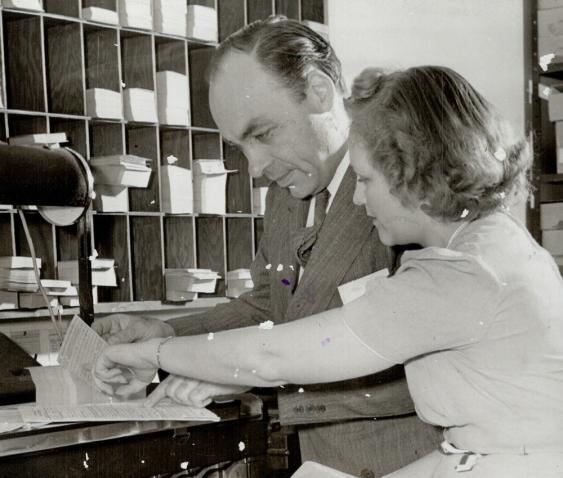
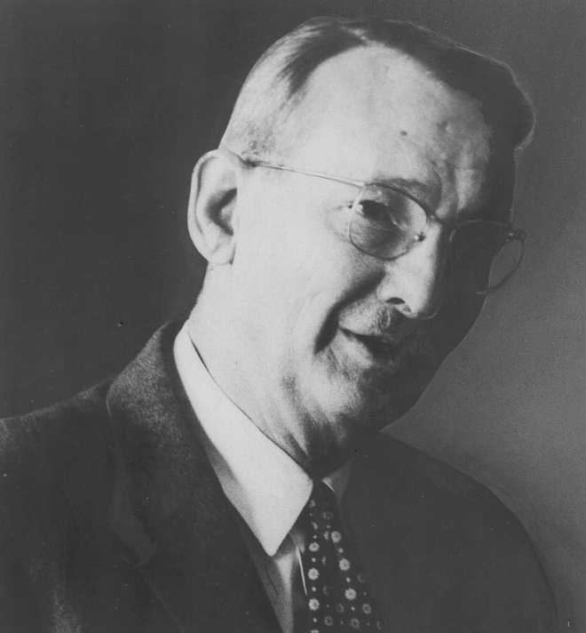
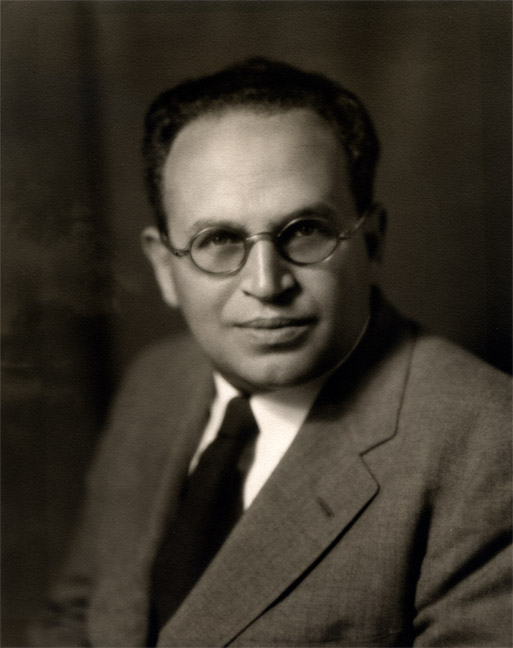
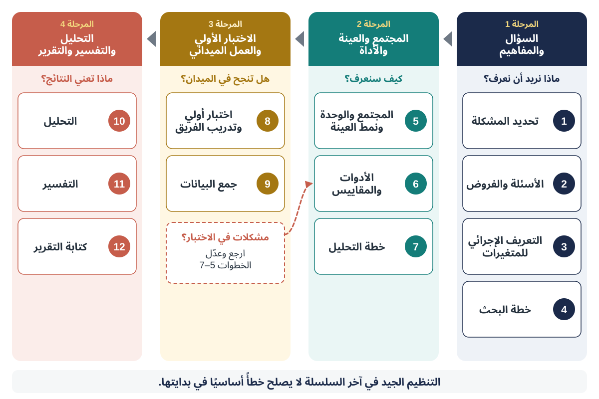
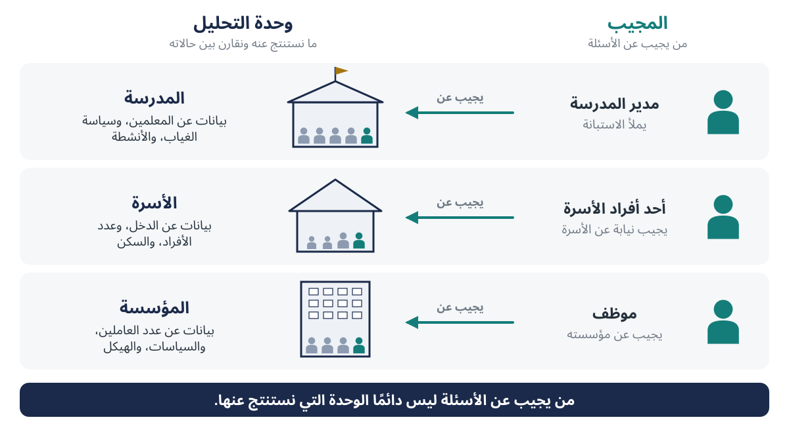
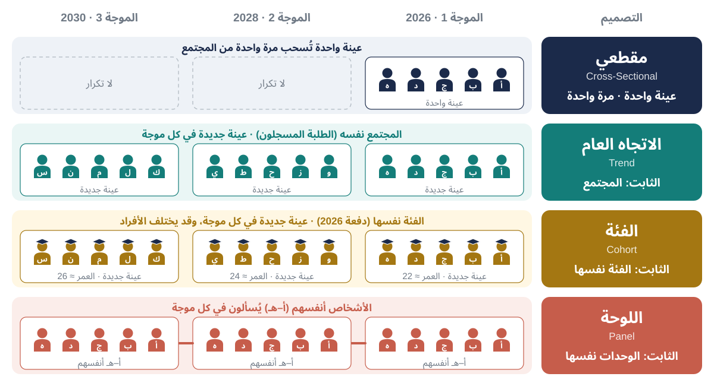
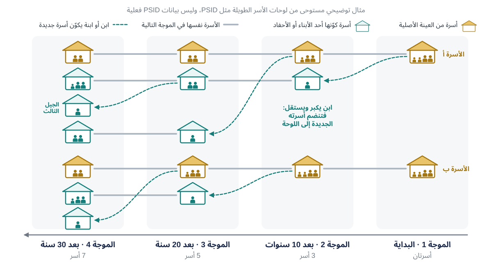
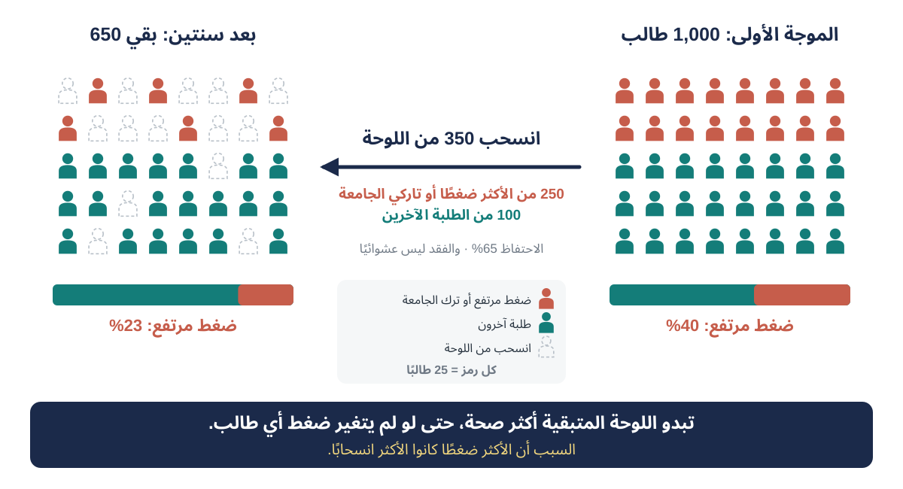
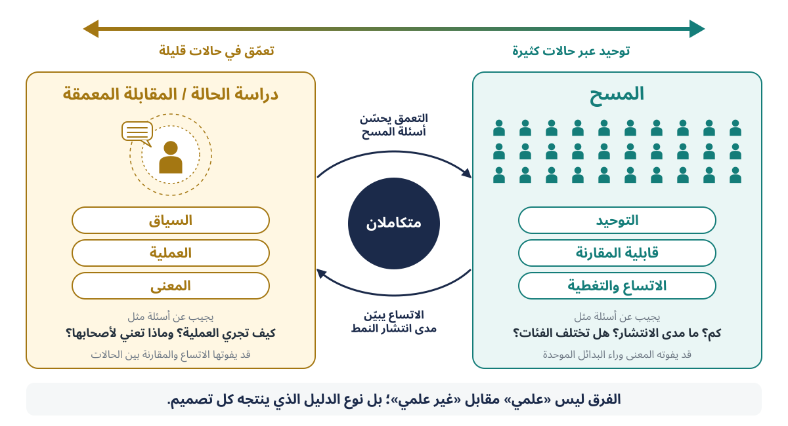
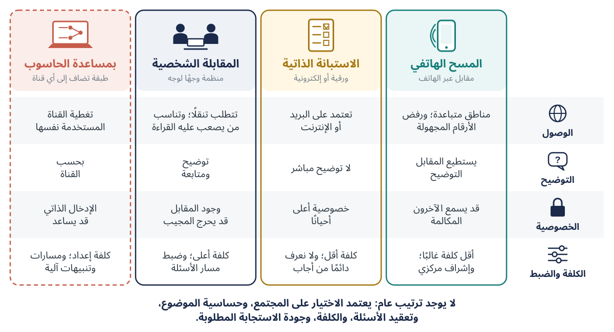

## المحاضرة الأولى: متى تكون الدراسة مسحًا اجتماعيًا؟

::: {.lecture-divider}
في الفصلين السابقين سألنا:

**مَن نختار؟ وكيف نجمع إجاباته؟**

والآن نسأل:

**متى تصبح هذه القرارات جزءًا من تصميم مسحي كامل؟**
:::

## استرجاع: الأداة ليست هي التصميم

::: {.question-box}
أرسل باحث استبانة إلكترونية إلى عينة من الطلبة.

هل تكفي كلمة «استبانة» لكي نعرف أن الدراسة مسح اجتماعي؟
:::

. . .

::: {.takeaway}
الاستبانة **أداة**، أما المسح فهو **تصميم لجمع إجابات منظمة من مجتمع أو عينة محددة خلال زمن محدد**.
:::

## ما المسح الاجتماعي؟

::: {.concept-card}
المسح الاجتماعي طريقة بحث تُطرح فيها أسئلة موحّدة نسبيًا على جميع وحدات مجتمع الدراسة أو على عينة منه؛ لوصف خصائصهم أو آرائهم أو خبراتهم، أو لفحص علاقات بين متغيرات.

Social Survey / Survey Research
:::

::: {.small}
قد تُطرح الأسئلة باستبانة ذاتية، أو مقابلة شخصية، أو هاتفية، أو إلكترونية.
:::

## ثلاث طبقات لا نخلط بينها

::: {.arrow-flow}
تصميم الدراسة: مسح  
↓  
نطاق التغطية والمعاينة: تعداد أو عينة، ثم طريقة الاختيار  
↓  
طريقة جمع الإجابات: ذاتية أو هاتفية أو شخصية
:::

::: {.takeaway}
قناة الجمع لا تحدد وحدها نوع العينة، ونوع العينة لا يحدد وحده المدة الزمنية للمسح.
:::

## نشاط: هل هذه دراسة مسحية؟

::: {.question-box}
صنّفوا الحالات:

1. مقابلات متعمقة مرنة مع ثماني أمهات عن تجربة الرعاية.
2. الأسئلة نفسها عن استخدام الخدمات تُطرح هاتفيًا على 1,200 شخص مختار.
3. تحليل 10,000 منشور عام من دون سؤال أصحابها.
4. استبانة موحدة تُرسل إلى جميع موظفي مؤسسة.
:::

. . .

::: {.board}
١ ليست مسحًا بالمعنى المقصود هنا · ٢ مسح · ٣ تحليل مضمون · ٤ مسح شامل للمؤسسة
:::

::: {.takeaway}
لا يحدد العدد وحده المسح؛ المهم وجود **أسئلة منظمة تُطرح على وحدات محددة** ضمن تصميم واضح.
:::

## العناصر الأساسية للمسح

::::: {.columns}
:::: {.column width="47%"}
- مجتمع أو عينة محددة
- أسئلة مرتبطة بأهداف البحث
- صياغة وترتيب موحّدان نسبيًا
::::

:::: {.column width="47%"}
- فترة زمنية واضحة
- إجراءات جمع قابلة للتوثيق
- تحليل يجيب عن أسئلة الدراسة
::::
:::::

## لماذا تُستخدم المسوح كثيرًا؟

::::: {.columns}
:::: {.column width="47%"}
- الوصول إلى عدد كبير
- مقارنة إجابات الأفراد
- تقدير نسب ومتوسطات
- وصف خصائص مجتمع
::::

:::: {.column width="47%"}
- قياس اتجاهات الرأي العام
- التخطيط للخدمات
- دراسة الأسواق
- اختبار فروض وعلاقات
::::
:::::

::: {.takeaway}
قوة المسح في إنتاج بيانات قابلة للمقارنة؛ وليست في كونه مناسبًا لكل سؤال.
:::

## تعداد أم مسح بالعينة؟

::::: {.columns}
:::: {.column width="47%"}
::: {.concept-card}
**التعداد**

محاولة جمع البيانات من جميع وحدات المجتمع.

Census
:::
::::

:::: {.column width="47%"}
::: {.concept-card}
**المسح بالعينة**

جمع البيانات من جزء مختار من المجتمع.

Sample Survey
:::
::::
:::::

## التعداد لا يلغي الخطأ

::: {.question-box}
أرسلت مؤسسة استبانة إلى جميع موظفيها، لكن نصفهم فقط أجاب.

هل أصبح لدينا تعداد كامل لأن الدعوة وصلت إلى الجميع؟
:::

. . .

::: {.takeaway}
لا. محاولة شمول الجميع لا تضمن استجابة الجميع، ولا تصلح سؤالًا ضعيفًا أو تسجيلًا خاطئًا.
:::

## من يستخدم نتائج المسوح؟

:::: {.survey-grid}
::: {}
**الحكومة**

السكان · الإسكان · الصحة · التعليم · الهجرة
:::
::: {}
**مراكز البحوث**

اختبار فروض · فهم سلوك · قياس مواقف
:::
::: {}
**مؤسسات الرأي العام**

اتجاهات الناخبين · المواقف من القضايا
:::
::: {}
**المؤسسات التجارية**

احتياجات المستهلكين · التسويق · تقييم الخدمات
:::
::::

## السؤال الذي يسبق المسح

::: {.question-box}
هل نحتاج أن نعرف:

- **كم؟ ومن؟ وما التوزيع؟**
- أم نحتاج أن نفهم **كيف عاش الشخص تجربة معقدة وبأي معنى؟**
:::

::: {.takeaway}
المسح قوي في الوصف والمقارنة، لكن المقابلة المعمقة أو الملاحظة قد تكون أنسب عندما نحتاج سياقًا وتفصيلًا لا تختصره إجابات موحدة.
:::

## لمحة تاريخية: من الحصر إلى البحث

- استخدمت المجتمعات القديمة الحصر لجمع معلومات عن السكان والموارد.
- أرسل كارل ماركس عام 1880 استبانة إلى عمال فرنسيين لدراسة الاستغلال.
- استخدم ماكس فيبر بيانات مسحية في أبحاثه الاجتماعية.

::: {.takeaway}
بدأ المسح مرتبطًا بالإدارة والحصر، ثم أصبح أداةً للبحث في المواقف والظروف والعلاقات الاجتماعية.
:::

## ثلاثة مسارات للتطور الحديث

::::: {.columns}
:::: {.column width="31%"}
::: {.concept-card}
**الإحصاء الرسمي**

تعدادات ومسوح سكانية واقتصادية
:::
::::

:::: {.column width="31%"}
::: {.concept-card}
**استطلاعات الرأي**

Gallup · Roper · Harris
:::
::::

:::: {.column width="31%"}
::: {.concept-card}
**مراكز الجامعات**

تطوير التصميم والتحليل والتدريب
:::
::::
:::::

## ماذا أضافت استطلاعات الرأي؟

::::: {.columns}
:::: {.column width="54%"}
- خبرة في اختيار العينات.
- تطوير صياغة الأسئلة.
- تنظيم جمع البيانات على نطاق واسع.
- إتاحة بيانات يمكن إعادة تحليلها.

::: {.concept-card}
التحليل الثانوي هو استخدام بيانات جُمعت سابقًا لغرض معين للإجابة عن سؤال بحث جديد.

Secondary Analysis
:::
::::

:::: {.column width="40%"}
{.history-photo fig-alt="جورج غالوب مع موظفة أمام آلة ميكانيكية لجدولة نتائج استطلاعات الرأي عام 1941"}

::: {.image-credit}
جورج غالوب وآلة لجدولة الآراء، 1941 · مصوّر غير معروف، Toronto Star Photograph Archive · ملكية عامة · [Digital Archive Ontario](https://digitalarchiveontario.ca/objects/260548/dr-gallup-looks-over-one-of-the-mechanical-counting-machine)
:::
::::
:::::

## ستوفر ولازارسفيلد

::::: {.columns}
:::: {.column width="47%"}
{.portrait fig-alt="صورة صموئيل ستوفر"}

**Samuel Stouffer**

طوّر استخدام المسوح لفهم آثار الأزمات والمواقف والظواهر الاجتماعية.
::::

:::: {.column width="47%"}
{.portrait fig-alt="صورة بول لازارسفيلد"}

**Paul Lazarsfeld**

استخدم دراسات تتبّع الناخبين أنفسهم خلال الحملات لفهم تغيّر المواقف.
::::
:::::

::: {.image-credit}
ستوفر: مصوّر غير معروف، نحو 1950، ملكية عامة · لازارسفيلد: Miremahe، CC BY-SA · [Wikimedia Commons](https://commons.wikimedia.org/wiki/File:Samuel_Andrew_Stouffer_(1900-1960)_portrait.png) و[Wikimedia Commons](https://commons.wikimedia.org/wiki/File:Lazarsfeld1941_Lge.jpg)
:::

::: {.takeaway}
لم يعد المسح مجرد عدٍّ للسكان؛ أصبح وسيلةً لدراسة **التغيّر والعلاقات والتفسير المحتمل**.
:::

## لا ندرس التاريخ للحفظ

::: {.question-box}
ما القرار المنهجي الذي نراه خلف هذا التطور؟
:::

. . .

::: {.board}
من جمع معلومات إدارية مرة واحدة  
إلى اختيار عينات، وتوحيد الأسئلة، وتكرار القياس، وربط الإجابات بخلفيات المشاركين
:::

## مسار البحث المسحي

{.chapter-visual-full fig-alt="مخطط خطوات البحث المسحي الاثنتي عشرة موزعة على أربع مراحل مترابطة"}

## الخطوات ١–٤: ماذا نريد أن نعرف؟

1. تحديد مشكلة البحث وتعريفها.
2. صياغة أسئلة البحث والفروض عند الحاجة.
3. التعريف الإجرائي للمتغيرات.
4. وضع خطة البحث.

::: {.takeaway}
لا يبدأ المسح بفتح منصة الاستبانة وكتابة أسئلة.
:::

## الخطوات ٥–٨: كيف سنعرف؟

5. تعريف المجتمع، ووحدة التحليل، ونمط العينة.
6. اختيار الأدوات والمقاييس.
7. تحديد خطة التحليل.
8. الاختبار الأولي وتدريب فريق المقابلات.

::: {.takeaway}
العينة والأداة والتحليل قرارات مترابطة، وليست أقسامًا منفصلة.
:::

## الخطوات ٩–١٢: من الميدان إلى الحجة

9. جمع البيانات.
10. تحليلها.
11. تفسير النتائج.
12. كتابة التقرير.

::: {.small}
التفسير يربط النتيجة بالسؤال والنظرية وحدود التصميم؛ ولا يكرر الجدول بكلمات فقط.
:::

## نشاط: أعيدوا ترتيب الدراسة

::: {.question-box}
رتّبوا القرارات التالية:

**اختبار الأداة · تعريف الضغط الدراسي · اختيار طلبة العينة · كتابة الفرض · تحليل الإجابات · تحديد المشكلة**
:::

. . .

::: {.board}
تحديد المشكلة ← تعريف المفهوم وكتابة الفرض ← اختيار العينة والأداة ← اختبار الأداة ← جمع البيانات ← التحليل
:::

## أين يمكن أن ينهار المسح؟

::: {.arrow-flow}
مجتمع غير محدد  
↓  
عينة لا تمثله  
↓  
سؤال لا يقيس المفهوم  
↓  
استجابة ناقصة أو غير صريحة  
↓  
تحليل لا يطابق التصميم
:::

::: {.takeaway}
العدد الكبير والتنظيم الجيد في آخر السلسلة لا يصلحان خطأً أساسيًا في بدايتها.
:::

## مختبر مشروعكم: هل المسح مناسب؟

::: {.question-box}
اكتبوا:

1. ما السؤال الذي سيجيب عنه المسح؟
2. من هو المجتمع؟
3. ما الذي سيُقاس بإجابات موحدة؟
4. ما الذي قد لا نفهمه من المسح وحده؟
5. هل نحتاج أداة أو تصميمًا آخر معه؟
:::

## المحاضرة الثانية: ليست كل المسوح متشابهة

::: {.lecture-divider}
يمكن تصنيف المسح بحسب:

**المجال · وحدة التحليل · الجهة والغرض · الهدف المعرفي · الزمن**
:::

## خمس عدسات للتصنيف

::: {.arrow-flow}
مَن يشمله؟  
↓  
ما وحدة التحليل؟  
↓  
من يستخدمه ولماذا؟  
↓  
ما نوع السؤال؟  
↓  
كم مرة نجمع البيانات؟
:::

::: {.takeaway}
الدراسة الواحدة تحمل أكثر من وصف في الوقت نفسه.
:::

## ١. بحسب المجال

::::: {.columns}
:::: {.column width="47%"}
**شامل**

يغطي جميع وحدات المجتمع المحدد، مثل تعداد السكان.
::::

:::: {.column width="47%"}
**بالعينة**

يختار جزءًا يفترض أن يمثل المجتمع وفق تصميم المعاينة.
::::
:::::

::: {.small}
«شامل» لا يعني شاملًا لكل البشر؛ بل لكل وحدات المجتمع الذي عرّفته الدراسة.
:::

## ٢. بحسب وحدة التحليل

قد تكون الوحدة فردًا، أو أسرةً، أو مؤسسةً، أو مسكنًا، أو جماعةً.

{.chapter-visual-compact fig-alt="ثلاثة أمثلة توضح الفرق بين الشخص الذي يجيب ووحدة التحليل التي نستنتج عنها"}

::: {.takeaway}
من يجيب عن الأسئلة ليس دائمًا هو الوحدة التي نستنتج عنها.
:::

## نشاط: ما وحدة التحليل؟

::: {.question-box}
أرسلت وزارة استبانة إلى مدير كل مدرسة، وسألته عن عدد المعلمين وسياسة الغياب والأنشطة، ثم قارنت المدارس.

من المجيب؟ وما وحدة التحليل؟
:::

. . .

::: {.board}
المجيب: المدير · وحدة التحليل: المدرسة
:::

## ٣. بحسب الجهة والغرض العملي

::::: {.columns}
:::: {.column width="31%"}
**حكومي**

التخطيط والسياسات والخدمات
::::

:::: {.column width="31%"}
**تجاري**

السوق والمستهلك والتسويق
::::

:::: {.column width="31%"}
**أكاديمي**

الوصف واختبار الفروض وبناء المعرفة
::::
:::::

::: {.takeaway}
الجهة الممولة لا تحدد جودة المسح تلقائيًا؛ نفحص السؤال والتصميم والشفافية والاستقلال.
:::

## ٤. بحسب الهدف المعرفي

::: {.arrow-flow}
استطلاعي: ما الذي يحدث؟ وما أبعاده؟  
↓  
وصفي: من؟ وكم؟ وكيف يتوزع؟  
↓  
تفسيري: لماذا ترتبط المتغيرات؟ وما التفسير الأقوى؟
:::

::: {.small}
قد يبدأ برنامج بحث بالاستكشاف، ثم ينتقل إلى الوصف، ثم يختبر تفسيرات محددة.
:::

## المسح الاستطلاعي

::: {.concept-card}
يستخدم عندما تكون المعرفة بالظاهرة محدودة، بهدف اكتشاف الأبعاد والخبرات والأسئلة الممكنة، لا اختبار فرض محدد بالضرورة.

Exploratory Survey
:::

::: {.example-box}
ما أبرز الصعوبات اليومية التي واجهتها أسر انتقلت حديثًا إلى مساكن مؤقتة؟
:::

## المسح الوصفي

::: {.concept-card}
يصف خصائص المجتمع أو توزيع المتغيرات فيه بدقة محددة.

Descriptive Survey
:::

::: {.example-box}
ما نسبة الأسر التي تحتاج دعمًا سكنيًا؟ وما توزيعها بحسب الحجم والمنطقة والدخل؟
:::

## المسح التفسيري

::: {.concept-card}
يفحص العلاقات بين المتغيرات في ضوء فروض أو تفسيرات نظرية.

Explanatory Survey
:::

::: {.example-box}
هل يرتبط عدم استقرار السكن بضعف الحضور المدرسي بعد أخذ دخل الأسرة في الاعتبار؟
:::

## نشاط: استطلاعي أم وصفي أم تفسيري؟

::: {.question-box}
1. ما الخبرات التي يصفها الطلبة عند استخدام نظام تسجيل جديد؟
2. ما نسبة الطلبة الذين تعذر عليهم تسجيل مقرر مطلوب؟
3. هل يرتبط تعذر التسجيل بتأخر التخرج؟
:::

. . .

::: {.board}
استطلاعي · وصفي · تفسيري
:::

## حدود التفسير في المسح

::: {.question-box}
وجد مسح مقطعي أن الطلبة الأكثر استخدامًا لخدمة الإرشاد أكثر رضا عن الجامعة.

هل أثبت أن الإرشاد **سبّب** الرضا؟
:::

. . .

::: {.takeaway}
لا. قد يسبق الرضا استخدام الخدمة، أو تؤثر متغيرات أخرى في الاثنين. العلاقة المسحية تحتاج تصميمًا أقوى قبل تفسيرها سببيًا.
:::

## المسح الواحد له أوصاف متعددة

::: {.design-card}
مسح هاتفي لعينة احتمالية من الأفراد، تجريه جهة حكومية مرة واحدة، بهدف وصف استخدام خدمة عامة.
:::

::: {.question-box}
صنّفوه بحسب: المجال، والوحدة، والجهة، والهدف المعرفي، والزمن.
:::

. . .

::: {.board}
بالعينة · الفرد · حكومي · وصفي · مقطعي
:::

## ٥. بحسب الزمن

::::: {.columns}
:::: {.column width="47%"}
::: {.concept-card}
**مقطعي**

جمع البيانات في نقطة أو فترة واحدة.

Cross-Sectional
:::
::::

:::: {.column width="47%"}
::: {.concept-card}
**طولي**

جمع بيانات قابلة للمقارنة في أزمنة متعددة.

Longitudinal
:::
::::
:::::

## المسح المقطعي: لقطة

::: {.timeline-line}
مجتمع الدراسة في خريف 2026 ← عينة واحدة ← جمع واحد
:::

يفيد في:

- تقدير نسبة أو متوسط الآن
- وصف خصائص المجتمع
- فحص علاقات في وقت واحد

::: {.takeaway}
يعطينا لقطة جيدة، لكنه لا يرينا كيف حدث التغير.
:::

## قوة المقطعي وحدوده

::::: {.columns}
:::: {.column width="47%"}
### ما يكسبه

- أسرع
- أقل كلفة غالبًا
- مناسب للوصف الحالي
::::

:::: {.column width="47%"}
### ما لا يعطيه وحده

- مسار التغير
- ترتيب الأحداث عبر الزمن
- تمييز تغير الأفراد من تغير المجتمع
::::
:::::

## نشاط: ماذا لا نعرف من اللقطة؟

::: {.question-box}
في نوفمبر 2026، وافق 60% من عينة الطلبة على التعليم المختلط.

ما الذي لا تخبرنا به هذه النسبة؟
:::

. . .

- هل كانت النسبة أعلى أو أدنى سابقًا؟
- من غيّر رأيه؟
- هل تغير الطلبة أنفسهم أم تغير تركيب المجتمع؟
- ما الذي سبق التغير المحتمل؟

## المسح الطولي: أكثر من زمن

::: {.timeline-line}
زمن ١ ← زمن ٢ ← زمن ٣
:::

::: {.concept-card}
يجمع بيانات قابلة للمقارنة عبر الزمن من مجتمع واحد، أو فئة مشتركة، أو الأشخاص أنفسهم.
:::

::: {.takeaway}
كلمة «طولي» لا تخبرنا وحدها **مَن الذي يتكرر**.
:::

## التكرار لا يعني الشيء نفسه دائمًا

قد نكرر:

1. القياس على **المجتمع نفسه** بعينات جديدة.
2. القياس على **الفئة المولودة أو المتخرجة نفسها** بعينات جديدة.
3. القياس على **الأشخاص أنفسهم**.

::: {.takeaway}
هذه هي الفكرة التي تميّز Trend وCohort وPanel.
:::

## الأنماط الزمنية الأربعة

{.chapter-visual fig-alt="مقارنة بصرية بين المسح المقطعي ودراسة الاتجاه العام ودراسة الفئة ودراسة اللوحة عبر موجات زمنية"}

## المحاضرة الثالثة: من يتكرر عبر الزمن؟

::: {.lecture-divider}
السؤال الحاسم:

**هل نتابع المجتمع، أم الفئة، أم الأشخاص أنفسهم؟**
:::

## تصميم الاتجاه العام

::: {.concept-card}
نجمع البيانات في أزمنة مختلفة من عينات مختلفة تمثل المجتمع نفسه في كل مرة.

Trend Study
:::

::: {.timeline-line}
طلبة الجامعة 2026: عينة أ ← طلبة الجامعة 2028: عينة ب ← طلبة الجامعة 2030: عينة ج
:::

## مثال: اتجاهات طلبة الجامعة

نقيس تأييد التعليم المختلط:

- 2026: عينة من الطلبة المسجلين.
- 2028: عينة جديدة من الطلبة المسجلين.
- 2030: عينة جديدة أخرى.

::: {.takeaway}
نعرف كيف تغيّر **مجتمع الطلبة**، لكننا لا نعرف مَن من الأفراد غيّر رأيه.
:::

## مثال آخر: مسوح ضحايا الجريمة

في كل سنة:

1. نختار عينة جديدة من سكان المدن نفسها.
2. نسأل عن التعرض للجريمة في السنة السابقة.
3. نقارن معدلات وأنماط التعرض عبر الزمن.

::: {.small}
إذا أُجري الجمع مرة واحدة فهو مقطعي؛ وإذا تكرر بعينات جديدة من المجتمع نفسه فهو Trend.
:::

## دراسة الفئة

::: {.concept-card}
نتابع فئة تشترك في حدث أو خبرة أو سنة بداية واحدة، مع إمكان اختيار أفراد مختلفين منها في كل موجة.

Cohort Study
:::

::: {.example-box}
مواليد سنة معينة · خريجو سنة معينة · من التحقوا بالجامعة في سنة معينة
:::

## مثال: دفعة خريجي 2026

::: {.timeline-line}
2026: عينة من خريجي دفعة 2026  
2028: عينة أخرى من دفعة 2026  
2031: عينة أخرى من دفعة 2026
:::

::: {.takeaway}
الفئة ثابتة: **دفعة 2026**. الأشخاص الذين يدخلون كل عينة قد يختلفون.
:::

## مثال: فئة عمرية تتحرك

::: {.timeline-line}
من كانوا بعمر 20 في 2026 ← يصبحون بعمر 25 في 2031 ← بعمر 30 في 2036
:::

::: {.takeaway}
لا نختار أشخاصًا عمرهم 20 في كل مرة؛ عندها نكون قد انتقلنا إلى فئات ميلاد مختلفة.
:::

## لماذا نستخدم Cohort؟

- متابعة أثر خبرة مشتركة.
- دراسة انتقال فئة من مرحلة إلى أخرى.
- تثبيت دفعة البداية ومتابعة مسارها.
- الاستفادة من بيانات سابقة عن الفئة نفسها.

::: {.small}
لا يكفي أن تكون الأعمار متقاربة؛ يجب أن تكون الفئة محددة بخبرة أو نقطة بداية مشتركة. وCohort واحدة لا تفصل أثر العمر عن أثر الفترة الزمنية.
:::

## دراسة اللوحة

::: {.concept-card}
نعود إلى الوحدات نفسها في كل موجة من جمع البيانات؛ وقد تكون أشخاصًا أو أسرًا أو مؤسسات أو مساكن.

Panel Study
:::

::: {.timeline-line}
الأشخاص أ، ب، ج في زمن ١ ← الأشخاص أ، ب، ج في زمن ٢ ← الأشخاص أ، ب، ج في زمن ٣
:::

## مثال: حملة انتخابية

نقابل الناخبين أنفسهم:

- قبل بدء الحملة.
- في منتصفها.
- قبل يوم الانتخاب.

::: {.question-box}
ما الذي نعرفه هنا ولا نعرفه من عينات جديدة كل مرة؟
:::

. . .

::: {.takeaway}
نعرف **مَن غيّر رأيه، وفي أي اتجاه، وما الخبرات التي رافقت التغير**.
:::

## مثال: دخل الأسرة عبر الزمن

{.chapter-visual fig-alt="مثال تخطيطي لمسح لوحي يتابع أسرًا أصلية ثم الأسر الجديدة التي يشكلها الأبناء عبر موجات متعددة"}

::: {.image-credit}
رسم أصلي مستوحى من منطق تصميم [Panel Study of Income Dynamics — University of Michigan](https://psidonline.isr.umich.edu/Guide/Brochures/PSID.pdf)، وليس عرضًا لبيانات PSID الفعلية.
:::

::: {.takeaway}
قوة Panel في ربط التغير داخل الوحدة نفسها بما حدث لها عبر الزمن.
:::

## المقارنة الأساسية

| التصميم | ما يبقى ثابتًا؟ | مَن يُسأل؟ |
|---|---|---|
| Trend | المجتمع | عينات مختلفة |
| Cohort | فئة ذات بداية مشتركة | أفراد قد يختلفون |
| Panel | العينة/الأشخاص | الأشخاص أنفسهم |

::: {.small}
كلها تصاميم طولية إذا تكرر الجمع عبر الزمن.
:::

## نشاط: صنّفوا التصميم

::: {.question-box}
1. عينة جديدة من سكان الكويت كل سنتين عن الثقة بالمؤسسات.
2. عينات متكررة من خريجي دفعة 2026.
3. الأشخاص أنفسهم يجيبون كل ستة أشهر.
4. عينة واحدة من الطلبة في نوفمبر 2026.
:::

. . .

::: {.board}
Trend · Cohort · Panel · Cross-Sectional
:::

## حالة خادعة: خريجون مختلفون

::: {.question-box}
في 2026 درسنا عينة من خريجي **دفعة 2020**.  
في 2030 درسنا عينة أخرى من خريجي **دفعة 2020**.

Trend أم Cohort؟
:::

. . .

::: {.takeaway}
**Cohort**؛ لأن الفئة ذات الخبرة المشتركة—دفعة 2020—هي نفسها، حتى لو تغير الأفراد.
:::

## حالة خادعة: دفعتان مختلفتان

::: {.question-box}
في 2026 درسنا خريجي دفعة 2025.  
في 2030 درسنا خريجي دفعة 2029.

هل نتابع Cohort واحدة؟
:::

. . .

::: {.takeaway}
لا. نقارن دفعتين مختلفتين. وقد يكون التصميم Trend إذا كانت كل دفعة تمثل مجتمع «الخريجين الجدد» في وقتها.
:::

## مقطعي أم Trend؟

::::: {.columns}
:::: {.column width="47%"}
**مقطعي**

عينة واحدة من مجتمع في وقت واحد.
::::

:::: {.column width="47%"}
**Trend**

عينات جديدة من المجتمع نفسه في أوقات متعددة.
::::
:::::

::: {.takeaway}
التكرار المنهجي القابل للمقارنة هو الذي يحوّل اللقطة إلى اتجاه زمني.
:::

## Trend أم Cohort؟

::::: {.columns}
:::: {.column width="47%"}
**Trend**

المجتمع العام نفسه، حتى لو دخل إليه أفراد جدد وخرج آخرون.
::::

:::: {.column width="47%"}
**Cohort**

فئة محددة ببداية أو خبرة مشتركة تتحرك عبر الزمن.
::::
:::::

## Cohort أم Panel؟

::::: {.columns}
:::: {.column width="47%"}
**Cohort**

نفس الفئة، لكن الأفراد قد يختلفون.
::::

:::: {.column width="47%"}
**Panel**

الأفراد أنفسهم بالضبط.
::::
:::::

::: {.takeaway}
قد نتابع الأشخاص أنفسهم من دفعة محددة، فيكون Panel داخل Cohort. أما Panel من عينة عامة فلا يصبح Cohort لمجرد ثبات الأشخاص.
:::

## عيادة اختيار التصميم

::: {.question-box}
ما الذي تريدون معرفته؟

- نسبة حالية؟
- تغير المجتمع؟
- مسار فئة ذات خبرة مشتركة؟
- تغير الأشخاص أنفسهم وأسبابه؟
:::

::: {.arrow-flow}
نسبة حالية ← Cross-Sectional  
تغير المجتمع ← Trend  
مسار فئة ← Cohort  
تغير الفرد ← Panel
:::

## نشاط: اختاروا التصميم

::: {.question-box}
اختاروا التصميم الأقرب:

1. نسبة استخدام ChatGPT بين الطلبة هذا الفصل.
2. تغير استخدام طلبة الجامعة له كل سنتين.
3. مسار دفعة المقبولين في 2026 حتى التخرج.
4. تغير استخدام الطلبة أنفسهم خلال فصل دراسي.
:::

. . .

::: {.board}
Cross-Sectional · Trend · Cohort · Panel
:::

## ما الذي يمنحه Panel؟

- قياس التغير داخل الشخص نفسه.
- معرفة اتجاه الانتقال، لا صافي الفرق فقط.
- ربط التغير بخبرات أو أحداث.
- تقليل بعض الفروق الثابتة بين أشخاص مختلفين.

::: {.takeaway}
هذه مزايا قوية، لكنها لا تجعل كل علاقة تظهر في Panel علاقة سببية.
:::

## هل Panel هو «الأفضل» دائمًا؟

::: {.question-box}
نريد تقدير رضا الطلبة عن التسجيل هذا الأسبوع فقط.

هل نحتاج إلى متابعة الأشخاص أنفسهم خمس سنوات؟
:::

. . .

::: {.takeaway}
لا. التصميم الأفضل هو الذي يجيب عن السؤال بكلفة ومخاطر معقولة. قد يكون المسح المقطعي هو الأنسب.
:::

## المحاضرة الرابعة: جودة المسح وتنفيذه

::: {.lecture-divider}
حتى التصميم الزمني المناسب قد يضعف بسبب:

**الاستنزاف · تغيّر القياس · قناة جمع غير مناسبة · أخطاء التنفيذ**
:::

## مشكلة الانسحاب عبر الزمن

::: {.concept-card}
يحدث الاستنزاف عندما يفقد التصميم بعض الوحدات التي كان مقررًا إعادة قياسها، بسبب الرفض أو تعذر الوصول أو الوفاة أو أسباب أخرى.

Attrition
:::

::: {.takeaway}
يخص ذلك Panel وأي تصميم يعيد الاتصال بالوحدات نفسها؛ لا Trend أو Cohort القائمين على عينات جديدة. والمشكلة ليست النقص العددي فقط، بل اختلاف المنسحبين بصورة منهجية.
:::

## نشاط: من بقي في Panel؟

::: {.question-box}
بدأنا بـ1,000 طالب. بعد سنتين بقي 650.

كان الانسحاب أعلى بين الطلبة الذين تركوا الجامعة والطلبة الأكثر ضغطًا.

كيف قد تتغير النتيجة النهائية؟
:::

## من بقي في Panel؟

{.chapter-visual-compact fig-alt="مخطط يبين كيف قد يؤدي الانسحاب الانتقائي من ألف مشارك إلى بقاء 650 شخصًا تبدو حالتهم أفضل من العينة الأصلية"}

::: {.takeaway}
قد يبدو الاستمرار الدراسي والرفاه أفضل من الواقع؛ لأن الفئات الأكثر عرضة للمشكلة غابت من الموجات اللاحقة.
:::

## كيف نتعامل مع الاستنزاف؟

- نحافظ على معلومات اتصال محدثة وآمنة.
- نخطط لتذكيرات مناسبة من دون ضغط.
- نوثق أسباب الفقد في كل موجة.
- نقارن الباقين بالمنسحبين بما يتوفر من بيانات.
- نستخدم تحليلًا يناسب البيانات الطولية والفقد.
- نذكر أثره المحتمل في الاستنتاج.

::: {.takeaway}
لا نعوّض المنسحب بشخص جديد ونستمر في تسميته الشخص نفسه.
:::

## التغير قد يدخل من فريق البحث أيضًا

في المسوح الطويلة قد يتغير:

- فريق المقابلات
- طريقة الاتصال
- صياغة الأداة
- نظام التسجيل
- تعريف المتغير

::: {.takeaway}
إذا تغير القياس، قد نخلط بين **تغير المجتمع** و**تغير طريقة جمع البيانات**.
:::

## التوحيد: قوة المسح

يساعد توحيد الأسئلة والمقاييس والإجراءات على:

- مقارنة المشاركين.
- المقارنة عبر الزمن.
- تقليل اختلاف التطبيق.
- الترميز والتحليل المنظم.

::: {.takeaway}
لا معنى لمقارنة موجتين إذا تغيّر السؤال الأساسي من غير تفسير أو معايرة.
:::

## التوحيد: مصدر ضعف محتمل

::: {.question-box}
ماذا يحدث إذا لم يجد المشارك تجربته داخل البدائل الموحدة؟
:::

. . .

- قد يختار أقرب بديل غير دقيق.
- قد تصبح الإجابة سطحية أو مصطنعة.
- قد تغيب فئة لم يتوقعها الباحث.
- قد نفقد معنى العملية الاجتماعية في سياقها.

## المسح ودراسة الحالة

{.chapter-visual fig-alt="مقارنة متوازنة بين ما تمنحه المسوح من توحيد وقابلية للمقارنة وما تمنحه دراسة الحالة والمقابلة المعمقة من سياق وعمق"}

::: {.takeaway}
الفرق ليس «علمي» مقابل «غير علمي»؛ بل نوع الدليل الذي ينتجه كل تصميم.
:::

## إيجابيات وسلبيات عامة

::::: {.columns}
:::: {.column width="47%"}
### إيجابيات

- بيانات كثيرة قابلة للمقارنة
- إمكان التعميم بتصميم مناسب
- وصف التوزيعات والعلاقات
- كفاءة المسح المقطعي
::::

:::: {.column width="47%"}
### سلبيات

- الاستجابة والتغطية والقياس
- سطحية بعض الإجابات
- كلفة المسوح الطولية
- الاستنزاف عند إعادة قياس الوحدات نفسها
- تعقيد التحليل والتنفيذ
::::
:::::

## قناة الجمع ليست تصميم الزمن

{.chapter-visual fig-alt="أربع قنوات لجمع بيانات المسح: الهاتف والاستبانة الذاتية والمقابلة الشخصية والجمع بمساعدة الحاسوب، مع مفاضلات سياقية"}

::: {.takeaway}
«هاتفي» يصف طريقة الاتصال. و«Panel» يصف مَن يتكرر عبر الزمن.
:::

## المسح الهاتفي

::::: {.columns}
:::: {.column width="47%"}
### نقاط قوة

- سريع وأقل كلفة غالبًا
- إشراف مركزي
- يسمح بالتوضيح
- يصل إلى مناطق متباعدة
::::

:::: {.column width="47%"}
### حدود

- رفض الأرقام المجهولة
- أسئلة قصيرة نسبيًا
- صعوبة البدائل الطويلة
- صعوبة ضمان الخصوصية أثناء المكالمة
- تغطية واستجابة غير متساويتين
::::
:::::

## الاستبانة الذاتية

::::: {.columns}
:::: {.column width="47%"}
### نقاط قوة

- أقل كلفة
- خصوصية أعلى أحيانًا
- يجيب المشارك في الوقت المناسب
- مناسبة لأسئلة تحتاج تفكيرًا
::::

:::: {.column width="47%"}
### حدود

- استجابة أقل أحيانًا
- تحتاج قراءة وفهمًا
- لا يوجد توضيح مباشر
- لا نعرف دائمًا من أجاب
::::
:::::

::: {.small}
قد تكون بريدية أو إلكترونية؛ القناة تغيّر مشكلات الوصول والتغطية.
:::

## المقابلة الشخصية المنظمة

::::: {.columns}
:::: {.column width="47%"}
### نقاط قوة

- استجابة وإكمال أعلى غالبًا
- توضيح ومتابعة
- مناسبة لمن يصعب عليهم القراءة
- ضبط أعلى لمسار الأسئلة
::::

:::: {.column width="47%"}
### حدود

- كلفة ووقت وتنقل
- أثر المقابل
- حاجة إلى تدريب وإشراف
- صعوبة الخصوصية
::::
:::::

## نشاط: اختاروا قناة الجمع

::: {.question-box}
1. عينة واسعة جغرافيًا، وأسئلة قصيرة غير حساسة.
2. مشاركون يحتاجون شرحًا ولا يجيد بعضهم القراءة.
3. موضوع حساس يخشى المشاركون من قوله أمام مقابل.
:::

::: {.small}
اختاروا قناة مبدئية، ثم اذكروا أكبر قيد فيها.
:::

. . .

::: {.takeaway}
قد توجد أكثر من إجابة قابلة للدفاع. القرار يوازن بين المجتمع، والخصوصية، وتعقيد السؤال، والكلفة، وجودة الاستجابة.
:::

## الحاسوب في المسوح

يساعد في:

- اختيار العينات وإدارة قوائم الاتصال.
- عرض السؤال والمسار الصحيح.
- إدخال الإجابة مباشرة.
- كشف بعض الإجابات المتناقضة.
- الترميز والتنظيف والتحليل.

::: {.concept-card}
المقابلة الهاتفية بمساعدة الحاسوب

CATI — Computer-Assisted Telephone Interviewing
:::

## منطق إلكتروني يقلل بعض الأخطاء

::: {.example-box}
إذا كانت المجيبة تقول:

- العمر الحالي: 30
- العمر عند الزواج: 24
- مدة الزواج: 12 سنة

يمكن للنظام أن ينبه إلى تناقض يحتاج مراجعة.
:::

::: {.takeaway}
الحاسوب يكشف قاعدة برمجناها؛ لا يعرف وحده المعنى الصحيح.
:::

## التقنية لا تصلح تصميمًا ضعيفًا

::: {.question-box}
استبانة إلكترونية جميلة فيها منطق انتقال ممتاز، لكنها منشورة كرابط مفتوح لا نعرف من وصله أو من أجاب.

ما الذي أصلحته التقنية؟ وما الذي بقي؟
:::

. . .

::: {.board}
قد تحسن المسارات والتسجيل · لكنها لا تصلح التغطية أو الاختيار الذاتي أو تعريف المجتمع
:::

## استديو المسح: مشروعكم

::: {.question-box}
ابنوا قرارًا مسحيًا واحدًا:

1. لماذا يناسب المسح سؤالكم؟
2. ما الهدف: استطلاعي أم وصفي أم تفسيري؟
3. مقطعي أم Trend أم Cohort أم Panel؟ ولماذا؟
4. ما قناة الجمع؟
5. ما أكبر مصدر خطأ أو فقد متوقع؟
6. ما الادعاء الذي لن يسمح به التصميم؟
:::

## تدقيق زميل: هل الاسم يطابق التنفيذ؟

اسألوا المجموعة الأخرى:

- هل هو مسح فعلًا؟
- هل الهدف المعرفي واضح؟
- من يتكرر عبر الزمن؟
- هل سمّوا التصميم الزمني بدقة؟
- هل خلطوا قناة الجمع بطريقة العينة؟
- هل الادعاء السببي أوسع من التصميم؟
- من قد يغيب أو ينسحب؟

## خريطة الفصل

::: {.arrow-flow}
سؤال يحتاج إجابات منظمة  
↓  
مجتمع وعينة وأداة  
↓  
هدف: استطلاع أو وصف أو تفسير  
↓  
زمن: لقطة أو تتبع  
↓  
Trend أو Cohort أو Panel  
↓  
جمع وتحليل واستنتاج بحدود واضحة
:::

## مصادر الفصل

::: {.small}
- المصدر الأساسي: الثاقب، فهد. *المدخل في البحث الاجتماعي*، الفصل السابع: «المسح الاجتماعي»، ص 173–189.
<!--
- تستند التصنيفات والأمثلة التاريخية والمقارنات بين قنوات الجمع إلى الفصل نفسه.
- أضيفت أمثلة جامعية وكويتية معاصرة، مع توضيح الفرق بين تصميم المسح، وتصميم الزمن، وطريقة المعاينة، وقناة جمع البيانات.
- عُدّلت فكرة أن Panel «أفضل» دائمًا: ملاءمة التصميم تعتمد على سؤال البحث، ولا يكفي التتبع وحده لإثبات السببية.
- مصدر مثال اللوحة الأسرية: University of Michigan، [Panel Study of Income Dynamics](https://psidonline.isr.umich.edu/Guide/Brochures/PSID.pdf).
- الصور التاريخية: Toronto Star Photograph Archive عبر Digital Archive Ontario؛ وصورتا Stouffer وLazarsfeld عبر Wikimedia Commons. تظهر تفاصيل الملكية والترخيص على الشرائح.
- جميع المخططات التوضيحية الأخرى رسومات أصلية أُعدّت لهذا العرض.
-->
:::

## السؤال الأخير

::: {.question-box}
أكملوا:

«اخترنا تصميم ______ لأننا نريد معرفة ______ عبر ______. سنجمع البيانات من ______ باستخدام ______. يسمح لنا التصميم أن نقول ______، لكنه لا يسمح لنا أن نقول ______.»
:::

::: {.takeaway}
المسح الجيد لا يبدأ بكثرة الأسئلة؛ يبدأ بتحديد **مَن نسأل، وماذا نريد أن نعرف، ومَن أو ما الذي يجب أن يتكرر عبر الزمن**.
:::
